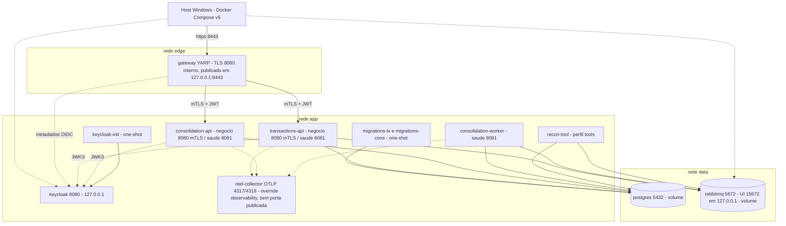
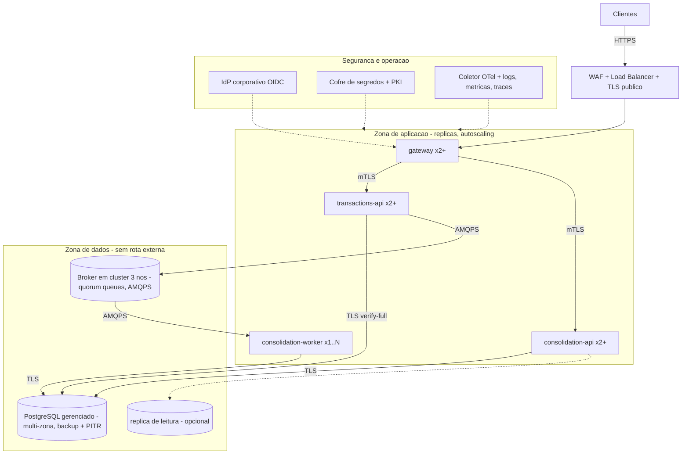

# Topologia e deployment

**Status (revisão F6, 2026-10-29):** a seção 1 descreve o Compose **que existe** em `infra/compose/` e o que foi **VALIDADO** em F6 (evidências em `docs/testing/evidence/f6/`); as seções 2, 3, 4 e 6 são **PROPOSTAS** (topologia-alvo, nada provisionado nem medido). O gateway, JWT e mTLS (F5) existem no Compose base e foram reexecutados na passada 3 (`29b-gateway-scenarios-rerun.log`); k6 e o ALVO seguem PROJETADOS. Decisão relacionada: G1-06 APROVADA em G1 / ADR-0010 ACEITO (alvo agnóstico; exemplo AWS só para custo; nada implantado). Convenção: **MVP** = Compose local; **ALVO** = produção descrita; **HIPÓTESE** = valor sem requisito fornecido.

---

## 1. Topologia local (Docker Compose) para demonstração

**Legenda de estado (usada em todo o documento):** **VALIDADO** = executado nesta base com evidência em `docs/testing/evidence/f6/` (ou fases anteriores); **IMPLEMENTADO** = existe em arquivo, sem execução própria registrada; **PROJETADO** = desenho sem arquivo ou sem execução. O Compose é demonstração: **não é HA** (uma instância de cada, sem failover, sem TLS entre apps, banco e broker).

### 1.1 Diagrama (o que existe em `infra/compose/`, pós-F5, F6 passada 3 em 2026-10-29)

Setas tracejadas para o coletor = só com o override de observabilidade. As APIs **não** publicam porta de negócio no Compose base; a única entrada é o gateway. O gateway **não** tem OTLP no override de observabilidade (gap, seção 8).

### 1.2 Containers (conferido contra `docker-compose.yml`, `docker-compose.dev.yml` e `docker-compose.observability.yml`)

| Serviço | Imagem | Redes | Portas no host | Healthcheck | Depende de | Estado |
|---|---|---|---|---|---|---|
| `postgres` | `postgres:17@sha256:31ba9c94...` (digest do manifest list, `21-image-digests.log`) | data | nenhuma; dev: `127.0.0.1:15432` | `pg_isready -h 127.0.0.1` | - | VALIDADO |
| `rabbitmq` | `rabbitmq:4-management@sha256:af6f50d3...` (efetiva lida: 4.4.0, `21-image-digests.log`) | data | `127.0.0.1:15672` (UI; exige o usuário de operação `RABBITMQ_OPS_*`) | `rabbitmq-diagnostics -q ping` | - | VALIDADO |
| `keycloak` | `quay.io/keycloak/keycloak:26.8.1@sha256:a78d6b79...` | app | `127.0.0.1:8080` (HTTP, só demonstração: obter token) | `/health/ready` na 9000 via `/dev/tcp` | - | VALIDADO (`29b-gateway-scenarios-rerun.log`) |
| `keycloak-init` | idem Keycloak (one-shot, `restart: "no"`) | app | nenhuma | exit 0 | `keycloak` healthy | VALIDADO |
| `migrations-tx`, `migrations-cons` | imagem da solução (`--migrate`, papel `migrator`) | app, data | nenhuma | exit 0 | `postgres` healthy | VALIDADO |
| `gateway` | `cashflow/gateway:dev` (YARP) | edge, app | `127.0.0.1:8443` -> 8080 (TLS da CA local) | `/health/ready` na 8081 (depende só dos metadados OIDC) | **nenhum** `depends_on` das APIs (502 enquanto sobem) | VALIDADO (`29b`) |
| `transactions-api` | `cashflow/transactions-api:dev` | app, data | nenhuma; dev: `18080` (negócio, HTTP), `18081` (saúde) | `/app/entrypoint --healthcheck .../health/ready`, `retries: 12` | **só** `migrations-tx`. Sem `depends_on` de broker (RNF-01) | VALIDADO |
| `consolidation-api` | `cashflow/consolidation-api:dev` | app, data | nenhuma; dev: `18082`, `18083` | idem | `migrations-cons` | VALIDADO |
| `consolidation-worker` | `cashflow/consolidation-worker:dev` | app, data | dev: `18084` (saúde) | idem; `ready` fica 503 sem consumidor por 60 s (C-21) | `migrations-cons`; broker só `service_started` | VALIDADO |
| `recon-tool` | `cashflow/recon-tool:dev` (perfil `tools`) | app, data | nenhuma | - | sob demanda | VALIDADO |
| `otel-collector` | `otel/opentelemetry-collector-contrib:0.116.1` por tag **e digest** (override) | app | nenhuma | - | - | VALIDADO (recebe; não persiste) |
| `k6` | `grafana/k6` (perfil `perf`) | edge + app (edge para chegar ao gateway; app para ler métricas/saúde) | nenhuma | - | sob demanda (F7) | **PROJETADO** |

Imagens base do `Dockerfile` (`sdk`, `aspnet`, `runtime` 10.0) também por digest. `restart: unless-stopped` em `postgres`, `rabbitmq`, `keycloak`, `gateway`, `transactions-api`, `consolidation-api` e `consolidation-worker`; jobs (`migrations-*`, `keycloak-init`, `recon-tool`) em `"no"`. **Limite:** o Compose não reinicia container `unhealthy`, só o que sai; o `restart` em si **não** foi exercitado (sem log).

**Tabela de portas (host, todas em `127.0.0.1`):**

| Porta | Serviço | Protocolo | Quando |
|---|---|---|---|
| `8443` | gateway | HTTPS (CA local; `curl --cacert infra/pki/out/ca.crt`) | Compose base |
| `8080` | keycloak | HTTP | sempre (só demonstração) |
| `15672` | rabbitmq (gestão) | HTTP | sempre; login só com o usuário de operação |
| `18080`-`18084`, `15432` | APIs/worker/postgres | HTTP / TCP | **só** override dev |

Regras que valem hoje: `transactions-api` não depende do broker nem na readiness nem no `depends_on` (publicar é assíncrono; o publisher reconecta) - **VALIDADO ANTES de F5** (executado em 2026-10-29 com o perfil dev, não refeito após F5/gateway) em `12-runbook-broker-down.log` (com o broker parado: POST 201 e **uma** sonda de `ready` da `transactions-api` = 200, linhas 3-4 do log; não é série contínua durante os 70 s). Healthchecks usam o listener interno de saúde (8081). A topologia AMQP e os usuários do broker são carregados pelo `entrypoint.sh` do container `rabbitmq` na partida (`load_definitions`, diretório `definitions.d`).

**Readiness e partida a frio (G1-15):** gateway e APIs ficam 503 em `/health/ready` até obter o JWKS do Keycloak (check `oidc-metadata`); por isso os healthchecks têm `retries: 12`. O roteiro de F5 mediu a stack saudável ~2 min (incluindo build) após `down -v` + `up --build` (`29b-gateway-scenarios-rerun.log`, seção 1).

As rotações de credenciais de PostgreSQL e RabbitMQ (`13-rotation-rabbit.log`, `14-rotation-pg.log`) também foram executadas **antes de F5** e não foram refeitas.

**Certificados:** o PKI local vem de `bash infra/pki/make-certs.sh` (pré-requisito; sem ele o Docker cria **diretórios** no lugar dos arquivos montados e gateway/APIs não sobem, fail-closed). P1-1 (auditoria F5): cada serviço monta **arquivos individuais** de `infra/pki/out/` em `/certs/` (somente leitura): gateway recebe `gateway-client.{crt,key}`, `gateway-edge.{crt,key}` e `ca.crt`; as APIs recebem o próprio par, `ca.crt` e `blocked-thumbprints.txt`. `ca.key`, `foreign-ca.key` e `neg-*` **não** entram em container algum (`29-certs-file-mounts.log`). O arquivo de bloqueio deve ser editado **em lugar** (`>`/`>>`); substituí-lo por outro arquivo (novo inode) deixa o container vendo o antigo. No Docker Desktop do Windows as permissões dentro do container aparecem como `rwxrwxrwx` (artefato do bind mount); o `chmod 600` do `make-certs.sh` não é verificável aqui.

As redes `app`/`data` **não** são `internal` (UI e portas publicadas exigem rede não interna); `internal: true` foi testado em projeto descartável sem portas, ANTES de F5 e não refeito (`16-internal-networks-test.log`): o worker não alcançou `1.1.1.1:53` ("Network is unreachable", enquanto o contêiner do projeto real conectou); postgres, rabbitmq, keycloak e worker ficaram `healthy` e o worker registrou 1 consumidor, mas **nenhuma mensagem trafegou** nesse teste; a `transactions-api` caiu (stack trace em `Program.cs:41`, fail-closed), mas **não** aplicado ao Compose (A5 adiada). As portas publicadas são só loopback; redes internas e um serviço de acesso do host para o perfil dev ficam como melhoria.

### 1.3 Sequência de subida (implementada)

0. `bash infra/pki/make-certs.sh` (uma vez) e `cp infra/compose/.env.example infra/compose/.env`.
1. `postgres` healthy (única pré-condição dura). `rabbitmq` e `keycloak` sobem em paralelo.
2. `migrations-tx` e `migrations-cons` aplicam as migrações e saem. Os privilégios mínimos por tabela vêm das próprias migrações (`ReadRoleLeastPrivilege`, `ReconRoLeastPrivilege`): **sem passo manual** (`23-pg-negative-after-p-db-1.log`).
3. `transactions-api` sobe após `migrations-tx` (mesmo sem broker), depois `consolidation-api` e `consolidation-worker`. `keycloak-init` aplica secrets e senhas após o import do realm.
4. `gateway` sobe sem aguardar as APIs; fica saudável quando obtém o JWKS.
5. (Opcional) override `docker-compose.observability.yml` adiciona o coletor e as variáveis OTLP aos 3 serviços .NET.

Demonstrações e como executá-las: `docs/runbooks/` (broker parado, worker parado/lag, DLQ, reconciliação/rebuild, certificados, IdP, segredos). Roteiro de F5 pelo gateway: `docs/testing/evidence/f5/gateway-compose-scenarios.sh` (reexecutado em `29b`). Roteiro de F4: `docs/testing/evidence/f4/verify-compose-scenarios.sh` **só vale com o override dev** (portas 18080/18082, `X-Dev-*`). Os cenários T-xx do plano de testes que dependem de carga pelo gateway (T-08) **não** foram executados.

### 1.4 Volumes e dados

- Volumes nomeados para `postgres` e `rabbitmq`; `docker compose down -v` é destrutivo (apaga bancos, fila e usuários do broker). Senhas do `init/` só valem em volume novo.
- Massa de demonstração: sem script de carga; os testes criam lançamentos de merchants sintéticos. Sem dados reais.

### 1.5 Perfil dev, k6 e o que segue PROJETADO

O perfil `docker-compose.dev.yml` mantém as APIs em HTTP puro com `X-Dev-*` e portas `18080`-`18084`; **o gateway não é funcional nesse perfil** (as APIs em `DevelopmentHeaders` ignoram o `Authorization` e o gateway remove `X-Dev-*`). Serve ao roteiro F4 e a verificações diretas. Segue **PROJETADO**: k6 em `edge` + `app` medindo pelo gateway com token do IdP (RNF-02, F7); TLS para banco/broker; CRL/OCSP.

---

## 2. Topologia-alvo (agnóstica de provedor)

| Componente | ALVO mínimo | Observação |
|---|---|---|
| Borda | WAF + LB com TLS público | Protege o gateway; não substitui JWT |
| gateway | ≥ 2 réplicas | Rate limit distribuído exige store compartilhado (FUTURO) ou limites por réplica declarados |
| transactions-api | ≥ 2 réplicas; publisher com `SKIP LOCKED` | Autoscaling por CPU/latência |
| consolidation-api | ≥ 2 réplicas | Alvo do pico de leitura |
| consolidation-worker | 1–N | Competing consumers com Inbox |
| PostgreSQL | Gerenciado, multi-zona, backup diário + PITR; um servidor com dois bancos (E1) ou dois servidores (E2) | Queda do servidor derruba o POST em qualquer topologia |
| Broker | Cluster de 3 nós, quorum queues, AMQPS | Perda de mensagem publicada e não consumida é coberta pela reconciliação. A `consolidation.dlq` hoje é `classic` (não replicada): ver seção 8 |
| IdP | Corporativo, HTTPS, HA | Keycloak HA ou gerenciado |
| Observabilidade | Coletor OTel, retenção e alertas | SLIs da seção 5 |

**Exemplo concreto apenas para custo (ADR-0010, HIPÓTESE):** AWS — ECS Fargate (aplicações), RDS PostgreSQL Multi-AZ, Amazon MQ for RabbitMQ, ALB + AWS WAF, Cognito ou IdP externo, CloudWatch, Secrets Manager/ACM. Não é escolha de provedor.

---

## 3. Arquitetura de transição (A-16)

Não há sistema legado nem dados a migrar; portanto **não é necessária** uma arquitetura de transição no sentido clássico (coexistência com sistema antigo). Em seu lugar, um **caminho de evolução por estágios**, sem reescrita:

| Estágio | Descrição | Mudança necessária |
|---|---|---|
| **E0 Protótipo** | Compose local; 1 instância de cada; um servidor PostgreSQL com dois bancos; broker 1 nó; Keycloak dev; mTLS gateway → APIs | — |
| **E1 Alvo pequeno** | Containers gerenciados com réplicas; PostgreSQL gerenciado (um servidor, dois bancos); broker em cluster; IdP corporativo; TLS em todos os canais; WAF | Configuração e infraestrutura; nenhuma mudança de código de domínio |
| **E2 Escala** | Dois servidores de banco (opção B do ADR-0001); réplica de leitura para a consulta; publisher em processo próprio; snapshot mensal para `closing_balance` se necessário | Connection strings e um processo adicional; contrato inalterado |

A separação em dois bancos desde E0 é o que torna E1 → E2 uma operação de infraestrutura (restore do `consolidation_db` em outro servidor + troca de connection string), não um projeto.

---

## 4. Estratégia de rollout, rollback e compatibilidade

1. **CI**: `restore` → `build` → testes → `dotnet format --verify-no-changes` → scan de dependências → imagem imutável por SHA. (Sem afirmar execução antes de ocorrer.)
2. **Migrações expand-contract**: toda mudança de schema em duas etapas (adicionar coluna/tabela/índice compatível → deploy da aplicação → remover o antigo em release posterior). Executadas por job antes do deploy, nunca no start com múltiplas réplicas. Índices criados `CONCURRENTLY` em produção.
3. **Deploy** rolling (ou blue/green) com `readiness`; `transactions-api` pronta sem broker; worker drena (`prefetch` pequeno, ACK por mensagem) antes de parar.
4. **Eventos**: `type` + `version` no payload e routing key `transaction.registered.v1`; consumidores toleram campos novos; mudança incompatível = `v2` em routing key nova; consumidores implantados antes dos produtores; `v1` mantido até esvaziar.
5. **Rollback**: aplicação volta à imagem anterior; banco **não** sofre rollback destrutivo (expand-contract garante compatibilidade); outbox/inbox só recebem alterações aditivas.
6. **Configuração e segredos** fora da imagem; certificados com rotação (manual no E0).
7. **Verificação pós-deploy**: SLIs da seção 5 por 15 min (HIPÓTESE) antes de concluir.

---

## 5. Observabilidade: SLIs, SLOs preliminares e evidência

| SLI | Definição | Fonte | SLO preliminar (PROP) | Como será evidenciado |
|---|---|---|---|---|
| Taxa de erro HTTP | `5xx / total` por rota e serviço | Métricas do gateway e das APIs | `GET` consolidado ≤ 1% em estado saudável (RNF-10); `POST` ≤ 0,1% | Export de métricas + resumo do k6 (T-08) |
| Taxa de perda (RNF-03) | `(5xx + 429 + timeouts + erros de conexão) / http_reqs` | k6 | ≤ 5% | `summary` JSON do k6 anexado ao evidence-log |
| Latência | p95/p99 por rota | APIs (histogramas) e k6 | p95 ≤ 300 ms, p99 ≤ 1 s (RNF-09) | k6 + dashboard |
| Lag de consolidação | `now − occurred_at` ao aplicar o evento | worker (`consolidation_lag_seconds`) | p95 < 5 s saudável; alarme > 60 s (HIPÓTESE) | T-11: atrasar o worker e observar |
| Outbox pendente | `COUNT(*) WHERE published_at IS NULL`; idade do mais antigo | publisher (`outbox_pending`, `outbox_oldest_age_seconds`) | alarme > 100 ou > 60 s (HIPÓTESE) | T-05: broker parado |
| Profundidade de fila e DLQ | `messages_ready`, `consolidation.dlq`; **idade da mais antiga na DLQ** (`dlq_oldest_age_seconds`) | RabbitMQ management/metrics | DLQ > 0 → alarme; idade > 7 d → alarme crítico (antes da retenção do Inbox, 30 d) | T-13 proposto |
| Consumo pausado | `ready` 503 do worker / 0 consumidores na fila (sinal em tempo real). `consumer_paused_seconds` é somado **só ao fim** da pausa (`ConsolidationConsumer.cs:252-256`): serve de histórico, não de alarme durante a pausa | worker / `rabbitmqctl` | ready 503 ou 0 consumidores > 60 s → alarme (HIPÓTESE) | T-04c, T-13 variante |
| Publicação sem rota / não confirmada | `outbox_unroutable_total`, `outbox_confirm_timeout_total` | publisher | > 0 → alarme | T-15, T-05b |
| Duplicatas detectadas | `inbox_duplicates_total` | worker | informativo (esperado > 0 em T-10 e T-14a) | T-10, T-14a |
| Divergências de reconciliação | `reconciliation_divergences_total{kind}` (`catch_up`, `corrected_corruption`, `anomaly`) | recon-tool | `anomaly` de **integridade** = 0 sempre; demais 0 após correção. **Atenção:** `anomaly` também é gravada pelo redrive da DLQ ao recusar mensagem ilegível (`DlqRedriver.cs:80,83`, triagem rotineira, esperada): alertar só sobre linhas sem `details.trail.mode='dlq_redrive'` (`docs/runbooks/dlq.md` seção 0; um `kind` distinto fica como melhoria) | RF-10, T-14a/b |
| Segurança | `authn_failed_total`, `authz_denied_total`, `rate_limited_total`, `mtls_handshake_failed_total` | gateway/APIs | informativo | T-07 |
| Saturação | CPU/memória, conexões de banco, threads | runtime .NET | informativo | dashboard durante T-08 |

**Estado das métricas da tabela acima (conferido no coletor, `09-otel-collector-raw.log` e `10-otel-traces-summary.log`, 2026-10-29):**

| Item | Estado | Observação |
|---|---|---|
| `outbox_pending`, `outbox_oldest_age_seconds`, `outbox_published_total` | **VALIDADO** (chegam ao coletor) | No ensaio do broker parado, o runbook leu pendente 1 e idade ~71 s por SQL (`12-runbook-broker-down.log`); o valor da métrica nesse ensaio não foi comparado |
| `consolidation_applied_total`, `consolidation_lag_seconds`, `dlq_messages_total` | **VALIDADO** (chegam) | Nenhum valor foi avaliado contra SLO. `dlq_messages_total` conta só as cópias feitas **pelo worker** à DLX; mensagens que chegam à DLQ por `delivery_limit` (broker) **não** entram |
| Métricas ASP.NET (`http.server.*`) e Npgsql | **VALIDADO** (chegam) | Base para taxa de erro e latência; nenhum valor foi comparado a SLO |
| `consumer_paused_seconds`, `inbox_duplicates_total` | **IMPLEMENTADO no código, NÃO VISTO** no coletor | Existem em `src/` (grep), mas não apareceram no export: provavelmente sem série até o evento ocorrer; não afirmar |
| `dlq_oldest_age_seconds`, `outbox_unroutable_total`, `outbox_confirm_timeout_total`, `reconciliation_divergences_total` | **NÃO ENCONTRADO** em `src/` nem no coletor (grep em 2026-10-29) | Hoje a idade da DLQ é medida por `rabbitmqctl`/runbook, não por métrica; as demais são PROJETADO |
| `authn_failed_total`, `authz_denied_total`, `rate_limited_total`, `mtls_handshake_failed_total` | **IMPLEMENTADO** (meter `CashFlow.Security`), **NÃO VISTO** no coletor | O override de observabilidade não liga o gateway e o perfil dev não usa JwtBearer; falta teste com tráfego 401/403/429 e OTLP no gateway (F7) |
| Logs | **VALIDADO**: 35 registros recebidos | Amostra; não houve varredura de campos sensíveis. Não prova ausência de `amount` |
| Traces por serviço | **VALIDADO**: spans de HTTP e Npgsql dos 3 serviços | 171 spans, 155 traces (`28-otel-summary.log`; antes 150/125) |
| **Trace contínuo publisher -> broker -> worker** | **NÃO COMPROVADO** | **0 traces com mais de um serviço**. Correção F7 (PF-12): o publisher **envia** o cabeçalho AMQP `traceparent` (`OutboxPublisher.cs:271-273`; observado em `evidence/f7/07-resilience.log:30`), mas o worker **não o extrai** para um span filho (sem `ActivitySource`/propagator em `CashFlow.Consolidation.Worker`), logo o trace continua descontínuo. Gap registrado como melhoria |
| Ruído de traces | Observado | 155 de 171 spans são `postgresql` da `transactions-api` (polling do outbox) |

### 5.1 Como a telemetria é entregue

- **VALIDADO:** o override `infra/compose/docker-compose.observability.yml` sobe **um** container receptor OTLP (`otel-collector`, gRPC 4317 / HTTP 4318, sem porta publicada) e define `OTEL_EXPORTER_OTLP_ENDPOINT` nos três serviços .NET (o exportador só liga se a variável existe). O exporter do coletor é `debug` (stdout): **prova recebimento; não retém, não consulta, não alerta**. Ver: `docker compose -f infra/compose/docker-compose.yml -f infra/compose/docker-compose.dev.yml -f infra/compose/docker-compose.observability.yml --env-file infra/compose/.env logs otel-collector`.
- **ALTERNATIVA NÃO VALIDADA:** Aspire Dashboard (UI de logs/métricas/traces) no lugar do `debug`. Era a candidata do desenho original; não foi executada em F6.
- **ALVO (PROJETADO):** coletor OTel + backends com retenção e consulta (provedor a definir, ADR-0010).
- Diretrizes de log: JSON com `trace_id`, `merchant_id`, `transaction_id`/`event_id`, rota e status; **sem** `amount`, tokens ou PII (`security.md` seção 9). Verificação por varredura: **não executada**.

### 5.2 Alertas - PROPOSTA (nenhum alerta existe, nenhum foi disparado)

Não há Alertmanager, regra ou canal de notificação. Limiares são HIPÓTESE para discussão:

| Alerta proposto | Condição (HIPÓTESE) | Severidade | Runbook |
|---|---|---|---|
| Outbox acumulando | `outbox_pending > 100` ou `outbox_oldest_age_seconds > 60` por 2 min | alta | `broker-indisponivel.md` |
| Lag de consolidação | `consolidation_lag_seconds` p95 > 60 s por 5 min | alta | `worker-parado-lag-consumo-pausado.md` |
| Worker sem consumidor | `ready` 503 do worker ou 0 consumidores na fila por > 60 s | alta | `worker-parado-lag-consumo-pausado.md` |
| DLQ não vazia | `consolidation.dlq > 0` | média; crítica se a mais antiga > 7 d (Inbox retém 30 d; redrive recusa > 29 d) | `dlq.md` |
| Divergência de reconciliação | `anomaly` de **integridade** (dois sentidos: ver seção 5, linha de divergências; o `anomaly` de triagem do redrive é rotina); demais após correção | alta | `reconciliacao-e-rebuild.md` |
| Credencial recusada | falha de autenticação no broker ou no banco | média | `rotacao-de-credenciais.md` |

Sem a métrica correspondente (tabela acima) o alerta **não é implementável** como escrito; os de DLQ e consumo dependem de exportar métricas do RabbitMQ (`rabbitmq_prometheus`) ou de novas métricas no código (não feito).
- **Evidência:** exportações textuais em `docs/testing/evidence/f6/`; nenhuma métrica de desempenho (RPS, p95) foi medida em F6.

---

## 6. Alta disponibilidade e recuperação

| Componente | O que a arquitetura garante | O que depende do provedor | RTO/RPO |
|---|---|---|---|
| `transactions_db` | Nenhum `201` sem commit durável; outbox republicável | HA multi-zona, backup, PITR | **A definir com o provedor**; não inventar |
| `consolidation_db` | Reconstruível **a partir de `transactions`** (modo reconstrução do `recon-tool`, nunca a partir da outbox); "RPO lógico 0" para dados derivados depende do RF-10, que **existe** (`recon-tool reconcile`/`rebuild`, F4; `reconcile` exercitado em F4/F6 com `clean`); o tempo de `rebuild` em volume real **não foi medido** | Backup para encurtar RTO | RTO = tempo de reconstrução; a medir |
| Broker | Mensagens não confirmadas permanecem na outbox (lease e `mandatory`); perdas de publicadas-não-consumidas detectadas e corrigidas pela reconciliação (opção (b)) | Quorum queues em 3 nós | A definir |
| APIs/worker | Stateless; réplicas | Orquestrador | Minutos (reinício) |
| IdP | Tokens válidos continuam aceitos com JWKS em cache | HA do IdP | A definir |

Backup e **teste de restore** do `transactions_db` são essenciais; sem restore exercitado não há RPO declarável.

---

## 7. Runbooks

Escritos em F6 em `docs/runbooks/` (cada comando está marcado **[EXECUTADO]** com o log em `docs/testing/evidence/f6/` ou **[NÃO EXECUTADO]**):

| Situação | Arquivo |
|---|---|
| Índice e convenções | `docs/runbooks/README.md` |
| Broker indisponível ou pausado (outbox acumula, POST segue 201) | `docs/runbooks/broker-indisponivel.md` |
| Worker parado, lag alto, consumo pausado | `docs/runbooks/worker-parado-lag-consumo-pausado.md` |
| DLQ: triagem por `x-reason`/`x-death` (incluindo mensagem **sem** `x-reason` por `delivery_limit`), evento com mais de 29 dias, registro em `reconciliation_runs` | `docs/runbooks/dlq.md` |
| `reconcile` e `rebuild` por `effective_date` | `docs/runbooks/reconciliacao-e-rebuild.md` |
| Rotação de credenciais (PostgreSQL, RabbitMQ, Keycloak, secrets de clientes via `keycloak-init`) | `docs/runbooks/rotacao-de-credenciais.md` |
| Rotação de certificados e revogação por blocklist | `docs/runbooks/certificados-e-revogacao.md` |
| IdP indisponível | `docs/runbooks/idp-indisponivel.md` |
| Diagnóstico de 401/403/429 e métricas de `CashFlow.Security` | `docs/runbooks/diagnostico-401-403-429.md` |

**Ainda sem runbook (PROJETADO):** `consolidation_db` indisponível (T-04c), restore de backup. Reset do ambiente: `infra/README.md`.

---

## 8. Gaps declarados

**Verificados em F6 (existem hoje):**
- Compose não é HA; nenhuma réplica ou cluster. TLS para banco, broker, IdP e telemetria ausente (`security.md`).
- **`restart: unless-stopped` aplicado (A2) mas não exercitado**; o Compose não reinicia container `unhealthy`. Não há log de queda de processo seguida de reinício.
- **Redes `app`/`data` não são `internal`** (A5 ADIADA): um container comprometido tem egress à internet. Mitigação parcial: todas as portas publicadas são só loopback. Teste de `internal: true` em `16-internal-networks-test.log` (bloqueia o egress; a `transactions-api` caiu, fail-closed). Redes internas com um serviço de acesso do host para o perfil dev ficam como melhoria.
- **Imagens por digest** (A3 aplicada): `postgres`, `rabbitmq`, `keycloak` e as 3 bases .NET fixadas no digest do manifest list lido em `21-image-digests.log`; isso torna a imagem reproduzível, mas **não** renova correções de segurança: o pin precisa ser atualizado à mão (procedimento no cabeçalho do `Dockerfile`). `rabbitmqctl version` lido do container em execução: 4.4.0 (o digest fixado foi lido do registro no mesmo momento; não foi comparado com o ID da imagem local).
- **Least privilege de PostgreSQL agora vem das migrações** (P-DB-1): `ReadRoleLeastPrivilege` (consolidation_db) e `ReconRoLeastPrivilege` (transactions_db); os `ALTER DEFAULT PRIVILEGES` amplos de `cons_ro`/`recon_ro` saíram de `init/02-databases.sql`. VALIDADO: `down -v` + up sem passo manual e consultas negativas (`23-pg-negative-after-p-db-1.log`), testes de matriz estrita (`22-dotnet-test-persistence-p-db-1.log`). Resta: `cons_worker` e `recon_writer` dependem de `GRANT` explícito das migrações, e `tx_app` ainda recebe default privileges amplos (DML) no `init`.
- **Usuário de operação do RabbitMQ repassado (A1):** `RABBITMQ_OPS_USER/PASS` opcionais (`:-`); sem eles não há login na UI 15672 (`26-rabbit-users-permissions.log`).
- **Sem job de expurgo** do Inbox (`processed_messages`) e da outbox publicada (C-15): a guarda de 29 dias do redrive existe, o expurgo não.
- **Sem tratamento de `connection.blocked`** no publisher (T-05b): sob alarme de memória/disco do broker o publicador pode bloquear sem erro explícito (registrado no runbook do broker). Item C para F7.
- **Sem span de consumo AMQP**: o `traceparent` **é** propagado como header pelo publisher (F7, PF-12), mas o worker não cria span a partir dele; trace publisher -> worker não é contínuo (seção 5; `28-otel-summary.log`: 171 spans, 155 traces, 0 com mais de um serviço).
- **Linux nativo não validado**: toda a validação desta topologia foi em Docker Desktop/WSL2 (Windows). Em engine Linux o bind mount preserva dono/modo e as chaves `600` geradas por `make-certs.sh` podem ser negadas ao uid 1654 das imagens .NET (F7, `evidence/f7/10-certs-permissions.log`, teste de mecanismo em volume efêmero; C-25 em `decisions-needed.md`). F7 ajustou `make-certs.sh` (chown 1654 ou chgrp + 640 em host Linux; senão falha com exit 3) e validou o mecanismo só em container Linux (`19-make-certs-linux.log`); falta host Linux nativo.
- **Sem alertas** (a seção 5.2 é PROPOSTA) e sem persistência de telemetria (exporter `debug`). O gateway não exporta OTLP (override de observabilidade só cobre os 3 serviços .NET de negócio, A8 mantida).
- Custo do `--healthcheck` .NET: ~0,55-0,64 s de relógio por `docker exec` (inclui o próprio exec, não só o processo .NET), a cada 10 s por serviço (A6, adiada).
- **Um único usuário AMQP de aplicação para três consumidores** (A10, decisão (b)): tx-api, worker e recon-tool usam `RABBITMQ_DEFAULT_USER`, com a união das permissões (`write` em `cashflow.transactions` e `cashflow.dlx`, `read` em fila e DLQ). O **alvo de produção** é um usuário por serviço (tx-api: só `write` em `cashflow.transactions`; worker: `read` da fila e `write` na DLX; recon-tool: `read` da DLQ e `write` em `cashflow.transactions`), conforme `target.md:315` e ADR-0003:26. O desvio no MVP é **risco aceito**: comprometer qualquer um dos três dá os três conjuntos de permissão. `target.md` e o ADR não foram alterados.
- **DLQ `consolidation.dlq` é `classic`** (`definitions.json`, bloco da fila): não é replicada em cluster RabbitMQ 4.x; a perda de um nó perde a DLQ. No ALVO (broker de 3 nós) é preciso reavaliar o tipo da DLQ (p.ex. quorum) ou aceitar o risco (a DLQ é evidência, o dado vive em `transactions`).
- **`keycloak-init` sem senha em argv (P2-9):** a senha do administrador e as novas senhas vão por `KC_CLI_PASSWORD` (prefixo do comando) e os secrets de cliente por stdin (`-f - --merge`); funcionou (`29b-gateway-scenarios-rerun.log`: tokens obtidos com os secrets aplicados). Continuam no **ambiente** do container (visíveis a quem lê `/proc/<pid>/environ` do mesmo usuário ou a `docker inspect`); a ausência em `ps` não foi observada diretamente, é consequência do desenho.
- **Realm e `.env`:** o import do realm não substitui `${env.*}`; secrets só existem depois do `keycloak-init`. Um `.env` antigo sem as 3 variáveis do Keycloak derruba `config`/`up` (`:?` deliberado).
- Aviso `libgssapi_krb5.so.2` nas imagens (inofensivo; ajuste de imagem registrado como melhoria).
- **Métricas de `CashFlow.Security`** (`authn_failed_total` etc.) existem no código mas **não** foram vistas no coletor: o override de observabilidade não liga o gateway e, no perfil dev, não há JwtBearer; contadores só emitem série após o primeiro evento.

**Herdados do desenho (PROJETADO):**
- Rate limit distribuído entre réplicas do gateway é FUTURO (o limite de 120 é **por instância**).
- **Cold start com IdP fora:** gateway/APIs reiniciados sem JWKS ficam com readiness falsa (503) e respondem `401 metadata_unavailable` a tokens válidos até o IdP voltar; processo já aquecido segue (JWKS em cache, refresh de 60 min). Alternativa JWKS persistido em volume (G1-15, `security.md` 3.3). Runbook: `docs/runbooks/idp-indisponivel.md`.
- Revogação só por blocklist de thumbprints (sem CRL/OCSP); conexões abertas no pool do gateway valem até 2 min.
- Servidor PostgreSQL compartilhado (opção C): degradação por disputa mitigada por orçamento de conexões e timeouts, não eliminada (`target.md` 7.2a).
- RTO/RPO sem números até haver provedor e teste de restore; backup/restore **não** foi exercitado.
- k6 não instalado no host; container a verificar em F7 (precisa das redes `edge` e `app`).
