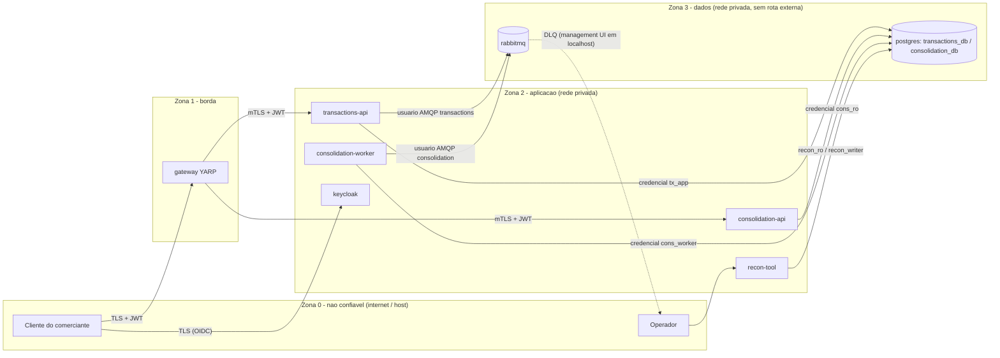
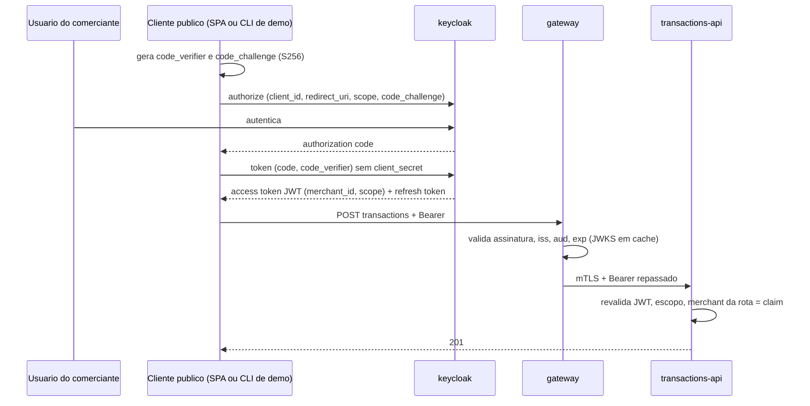
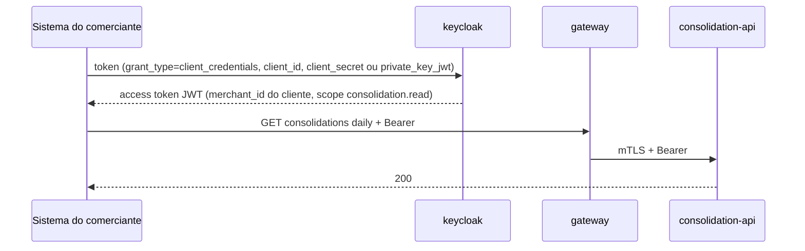

# Modelo de segurança corporativa — MVP implementado em F5; ALVO descrito

**Status (F5, 2026-10-29): os controles marcados "Implementado (F5)" existem no código e no Compose base; os marcados "Validado" têm saída real em `docs/testing/evidence/f5/` (seções 11 e 12 dizem qual).** O restante continua projetado (ALVO) ou declarado como GAP. Este documento nunca chama TLS unilateral de mTLS. Decisões relacionadas: ADR-0003 (limites), ADR-0006 (tenant), ADR-0011 (IdP, Gateway, mTLS); G1 aprovado. Itens que F5 **propôs** (sem decidir) estão em `docs/project/decisions-needed.md`.

Convenção: **MVP** = implementado/demonstrado no protótipo; **ALVO** = produção, descrito; **GAP** = ausência declarada no protótipo; **HIPÓTESE** = número ou escolha sem requisito fornecido; **Implementado (F5)** = código + configuração existem; **Validado** = há log real de execução.

---

## 1. Zonas e limites de confiança

| Limite | O que cruza | Controle MVP | Controle ALVO |
|---|---|---|---|
| Z0 → Z1 | Requisições do cliente | TLS 1.2+ (certificado de desenvolvimento), JWT validado, rate limit, limite de payload, headers | TLS com certificado público, WAF, geo/IP allowlists se aplicável |
| Z0 → Z2 (IdP) | Login e emissão de token | Keycloak exposto em `localhost` apenas para a demonstração; HTTPS do IdP = GAP (modo dev) | IdP corporativo em HTTPS, MFA, políticas de senha |
| Z1 → Z2 | Encaminhamento às APIs | **mTLS** (APIs exigem certificado de cliente do gateway) + JWT revalidado nas APIs | mTLS com PKI gerenciada e rotação automática |
| Z2 → Z3 | Acesso a banco e broker | Rede privada do Compose, credenciais por serviço, privilégio mínimo; **sem TLS = GAP** | TLS obrigatório (`sslmode=verify-full`, AMQPS), credenciais rotacionáveis, cert-auth opcional |
| Z2 → telemetria | OTLP | Rede privada, sem TLS = GAP; sem PII/valores | OTLP com TLS e autenticação |
| Z2 → IdP | JWKS | HTTP interno = GAP; cache local | HTTPS; pinning de issuer |

---

## 2. Matriz canal × protótipo × alvo (TLS, mTLS ou privado)

| Canal | Protótipo (MVP) | Alvo | Nunca chamar de |
|---|---|---|---|
| Cliente → gateway | **TLS unilateral — Implementado (F5)**: Compose base publica só `https://127.0.0.1:8443` com `gateway-edge.crt` da CA local (`curl --cacert infra/pki/out/ca.crt`); sem HSTS (certificado não público); no perfil `docker-compose.dev.yml` a borda é HTTP puro em `18443` | TLS unilateral com certificado público + HSTS + WAF | mTLS |
| gateway → transactions-api | **mTLS — Implementado (F5), Validado (T-17)**: Kestrel `RequireCertificate`, cadeia contra a CA local (`CustomRootTrust`), EKU `clientAuth`, SAN `gateway.internal`, blocklist de thumbprint; o gateway valida o certificado da API contra a mesma CA (`UpstreamHttpClientFactory`) | mTLS com PKI gerenciada | — |
| gateway → consolidation-api | **mTLS — Implementado (F5), Validado (T-17)** (idem) | mTLS | — |
| APIs/worker/recon → PostgreSQL | Rede privada, senha por role, **sem TLS (GAP)** | TLS `verify-full`; cert-auth opcional | TLS |
| publisher/worker → RabbitMQ | Rede privada, usuário/senha por serviço, vhost, **sem TLS (GAP)** | AMQPS com certificados; usuários/permissões por fila | TLS |
| gateway/APIs → Keycloak (JWKS) | HTTP na rede privada **(GAP)**; só com opt-in explícito `Authentication:JwtBearer:AllowHttpMetadata=true` (padrão: HTTPS obrigatório, a partida falha com `http://` sem a flag; aviso no log) | HTTPS | TLS |
| Cliente → Keycloak | HTTP em `127.0.0.1:8080` **(GAP, só demo)**; `KC_HOSTNAME` fixo faz o `iss` ser sempre `http://keycloak:8080/realms/cashflow` | HTTPS | TLS |
| Serviços → telemetria | OTLP sem TLS **(GAP)** | OTLP com TLS/autenticação | TLS |
| Operador → RabbitMQ management | Porta ligada a `127.0.0.1` | Bastion/SSO; sem exposição pública | — |

---

## 3. Fluxos OIDC

### 3.1 Usuário humano — Authorization Code + PKCE (cliente público `cashflow-web`)

### 3.2 Sistema integrador — Client Credentials (`merchant-a-system`)

Regras: nenhum `client_secret` em SPA; `private_key_jwt` como ALVO para integradores; refresh token com rotação.

### 3.3 Token: claims e validação

| Item | Implementado (F5) em `src/CashFlow.Hosting/Security` (gateway e APIs usam o mesmo código) | Observação |
|---|---|---|
| `iss` | `ValidIssuer` **obrigatório e exato** (`Authentication:JwtBearer:ValidIssuer`; Compose: `http://keycloak:8080/realms/cashflow`); `ValidateIssuer=true` fixo no código | Validado (T-18): token do mesmo Keycloak e mesmas chaves, pedido por outro host → `401` `invalid_issuer` |
| `aud` | `ValidAudience=cashflow-api` (padrão) exigida; realm emite via **audience mapper** no escopo `cashflow-api`, default dos três clientes | Validado (T-18): cliente-sonda sem o escopo `cashflow-api` → `401` `invalid_audience` |
| Metadados OIDC | `MetadataAddress` obrigatório (`http`/`https`); `RequireHttpsMetadata = !AllowHttpMetadata`; **`AllowHttpMetadata` é opt-in explícito** (Compose: `true`, GAP, aviso no log) — não depende do ambiente | Proposta ao líder (relatório F5): manter como GAP declarado do Compose ou subir o Keycloak com TLS em F7 |
| Algoritmos aceitos | `ValidAlgorithms` padrão `["RS256","ES256"]`; a configuração **recusa** `none`, `HS*` e qualquer algoritmo fora da lista assimétrica; `MapInboundClaims=false` | Validado (T-18): `alg=none`, `HS256` com `kid` real e payload adulterado → `401` sem detalhe do motivo no corpo |
| `typ` (cabeçalho JOSE) | `ValidTokenTypes` padrão `["JWT","at+jwt"]` → `TokenValidationParameters.ValidTypes` (lista fechada, não pode ficar vazia). O Keycloak 26 escreve `JWT` no **cabeçalho** dos access tokens (`Bearer` é a claim `typ` do payload, que o IdentityModel não valida); `at+jwt` é a opção RFC 9068 por cliente. Outro `typ` → `401` `invalid_type` | Validado (`TokenClockAndKeyRotationTests`, emissor de teste): `JWT`/`at+jwt` → `200`; `Bearer`/`ID`/`Logout` no cabeçalho → `401` `invalid_type` |
| Tolerância de relógio | `ClockSkewSeconds` padrão 30 (faixa 0–300) | Testes com Keycloak usam 0 para provar `expired` sem tolerância. Limites validados com emissor de teste e skew 30 (`TokenClockAndKeyRotationTests`): `nbf` +20 s → `200`, +45 s → `401` `not_yet_valid`; `exp` −20 s → `200`, −45 s → `401` `expired` |
| Vida do access token | Realm: 300 s (`accessTokenLifespan` e por cliente); sem refresh token nos clientes `*-system` | 15 min para humanos **não** aplicado: `cashflow-web` também usa 300 s (HIPÓTESE simplificada) |
| Refresh token | Só `cashflow-web` (`refreshTokenMaxReuse=0`, sessão SSO 30 min ociosa / 10 h) | PKCE configurado, **não demonstrado** (sem front-end) |
| `scope` | `transactions.write`, `transactions.read`, `consolidation.read` são escopos **opcionais** do realm: o cliente pede em `scope=`; `azp` aparece sempre; política por endpoint em `AuthorizationSetup` | Validado (T-18): token sem o escopo da rota → `403` `authz_denied_total`. Proposta ao líder: opcionais (mínimo privilégio por pedido) × default por cliente |
| `merchant_id` | UUID por **mapper fixo** nos clientes `*-system` e por **atributo do usuário** (editável só por admin, user profile) no `cashflow-web`; ausência/formato inválido → `403` (`TenantFilter`) | Validado (T-28): rota ≠ claim → `404`; claim adulterada → `401` (assinatura) |
| `roles` | **Não implementado**: a autorização do MVP é por escopo + `merchant_id`; `ops_operator` não existe como papel de API | GAP declarado; ALVO: papéis para operação |
| `sub`, `azp`/`client_id` | Exigidos por `Caller.TryFrom`. **Achado F5:** o import de realm com `clientScopes` explícito não cria os escopos embutidos; sem o escopo `basic` (mapper `oidc-sub-mapper`) o token Client Credentials vem **sem `sub`**. O realm versionado define `basic` e o põe nos defaults dos três clientes | `jti` não é persistido (GAP leve: auditoria usa `sub`/`azp`/trace) |
| JWKS | `ConfigurationManager` compartilhado: refresh automático a cada `MetadataRefreshMinutes` (60); `kid` desconhecido força refresh limitado a 1 por 5 min; metadados indisponíveis → `401` `metadata_unavailable` (nunca `500`) e readiness `503` (`oidc-metadata`) | Validado (T-07): processo aquecido segue com o IdP parado. Rotação de chave validada (`TokenClockAndKeyRotationTests`): primeiro token com `kid` novo → `401` `unknown_signing_key` (o handler pede o refresh e **não** revalida na mesma requisição), segundo → `200`; chave antiga segue aceita; chave nunca publicada → `401` sempre. GAP-F5-01 (seção 11): a sonda de `KeyNotFoundReasonAsync` pode amplificar tráfego ao IdP |

**Estratégia de issuer (PROPOSTA, G1-14).** O problema: o Keycloak em modo dev emite `iss` conforme o host da requisição; o host (demo, k6) o alcança por `localhost:8080` e os containers por `keycloak:8080`, o que produz dois issuers e induz `ValidateIssuer = false`. Recomendação: `KC_HOSTNAME=http://keycloak:8080` (hostname fixo, `KC_HOSTNAME_STRICT=true`), de modo que **todo** token traz `iss = http://keycloak:8080/realms/cashflow`; no host, entrada `127.0.0.1 keycloak` no arquivo `hosts` para a demonstração (HIPÓTESE operacional). O **k6 fica só na rede `edge`** (`deployment.md` 1.2): simula um cliente externo e só precisa do gateway; obtém e renova o token no IdP publicado no host (`host.docker.internal:8080`, HIPÓTESE Docker Desktop) — o `iss` não muda porque `KC_HOSTNAME` é fixo. Só o runner de testes de integração que precise falar com as APIs diretamente (T-17, T-28) entra em `app`. Alternativa: `KC_HOSTNAME=http://localhost:8080` (issuer `localhost`) com `ValidIssuer` explícito nas APIs e `MetadataAddress` interno apontando para `keycloak:8080` — funciona, mas acopla a configuração à demo. Proibido em ambas: `ValidateIssuer = false`, lista de issuers aberta, `RequireHttpsMetadata = false` sem opt-in explícito (`AllowHttpMetadata`; a partida falha em **qualquer** ambiente sem a flag — ver 3.3 e C-F5-01).

**Implementado (F5):** a recomendação (`KC_HOSTNAME=http://keycloak:8080`, `KC_HOSTNAME_STRICT=true`, `ValidIssuer` explícito) está no Compose base. **A entrada no `hosts` não foi necessária**: um token pedido ao `127.0.0.1:8080` já vem com `iss=http://keycloak:8080/realms/cashflow` e é aceito pelo gateway e pelas APIs (roteiro `docs/testing/evidence/f5/gateway-compose-scenarios.sh`, seção 2). Ela só seria necessária para um navegador seguir os redirects do PKCE (não demonstrado). O `RequireHttpsMetadata` ficou como opt-in por configuração (`AllowHttpMetadata`), não por ambiente: sem a flag, `MetadataAddress` em `http` derruba a partida em qualquer ambiente, inclusive `Development` (`JwtBearerSettings.Validate`) — ver 3.3 e C-F5-01.

**IdP indisponível:** gateway e APIs continuam validando com chaves em cache **em processo já aquecido** (JWKS obtido ao menos uma vez); tokens válidos seguem aceitos até expirar; novos logins e renovações falham (erro do IdP, não das APIs); rotação de chave durante a indisponibilidade invalidaria tokens novos, não os antigos. Nenhuma degradação do `POST` para clientes com token válido **nessa condição**. **GAP declarado (G1-15):** reinício do gateway ou de uma API com o IdP fora não obtém JWKS; a readiness permanece falsa até o IdP voltar (o `POST` fica indisponível no cold start). Alternativa: persistir o último JWKS válido em volume e aceitá-lo na partida com idade máxima (HIPÓTESE 24 h); custo: chave rotacionada durante a queda não é conhecida até o IdP voltar.

**Validado (F5, T-07, `IdpOutageTests`):** com o Keycloak parado (`docker stop`), gateway e API aquecidos respondem `201` e `/health/ready` `200`; uma API que sobe a frio responde `/health/ready` `503` (corpo padrão `Unhealthy`; o nome do check `oidc-metadata` fica só no log do processo), `/health/live` `200` e `401` `metadata_unavailable` a um token válido (não `500`); quando o IdP volta, ela fica pronta sozinha, sem reinício (limite do teste: 90 s). O GAP G1-15 permanece (sem JWKS persistido). Achado de implementação: o `JsonWebTokenHandler` engole a falha de obtenção do documento (IDX10261) e falha com `SecurityTokenSignatureKeyNotFoundException`, a mesma exceção de um `kid` novo; `JwtBearerSetup.KeyNotFoundReasonAsync` distingue os dois casos consultando o cache compartilhado (com documento em cache → `unknown_signing_key`; sem documento e IdP inacessível → `metadata_unavailable`).

---

## 4. Autorização

### 4.1 Política única de respostas (ADR-0006)

| Situação | Resposta | Registro |
|---|---|---|
| Sem token, assinatura/iss/aud inválidos, expirado | `401` + `WWW-Authenticate` | Métrica `authn_failed_total` por motivo; sem token no log |
| Token válido sem escopo/papel do endpoint | `403` | Auditoria (`sub`, `azp`, rota, `trace_id`; `jti` não é persistido — 3.3) |
| Rota ou recurso de **outro merchant** | `404` indistinguível de inexistente | Auditoria `authz_cross_tenant_denied_total` (sub, merchant do token, merchant da rota) |
| Acima do rate limit | `429` + `Retry-After` | Métrica por rota e merchant |

**Implementado (F5), Validado (T-18/T-28):** `401` em `application/problem+json` com `WWW-Authenticate: Bearer realm="cashflow"` (sem token) ou `..., error="invalid_token"`; motivos em `authn_failed_total{reason}`: `missing_token`, `expired`, `not_yet_valid`, `invalid_audience`, `invalid_issuer`, `invalid_algorithm`, `invalid_type`, `unknown_signing_key`, `invalid_signature`, `malformed`, `invalid_token`, `metadata_unavailable`; o corpo **não** carrega o motivo (nada de `IDX...`). `403` → `authz_denied_total`. `404` cross-tenant com o **mesmo** `title`/`type`/`status` do recurso inexistente → `authz_cross_tenant_denied_total` no Meter do serviço (`CashFlow.Transactions`/`CashFlow.Consolidation`). `429` → `rate_limited_total{route}`. A API repete todas as checagens do gateway (defesa em profundidade; o gateway não é confiado como autenticador).

### 4.2 Matriz papel × endpoint

| Endpoint | `merchant_user` | `merchant_system` | `ops_operator` | Escopo exigido |
|---|---|---|---|---|
| `POST /merchants/{m}/transactions` | Sim (m = claim) | Sim (m = claim) | Não | `transactions.write` |
| `POST /merchants/{m}/transactions/{id}/reversal` | Sim | Sim | Não | `transactions.write` |
| `GET /merchants/{m}/transactions[...]` | Sim | Sim | Não | `transactions.read` |
| `GET /merchants/{m}/consolidations/daily` | Sim | Sim | Não | `consolidation.read` |
| `/health/*` dos serviços | Não via gateway | Não | Sim (rede interna) | — ; servido por **listener de saúde separado** (porta interna sem publicação, sem mTLS) que atende **apenas** `/health/*`: endpoints de negócio são mapeados **somente** à porta mTLS (Kestrel: endpoints por porta via middleware que compara `Connection.LocalPort` com a porta de saúde — **não** `RequireHost`, pois o cabeçalho `Host` é controlado pelo cliente; implementado em F2 em `CashFlow.Hosting/ListenerIsolationMiddleware.cs`), de modo que rota de negócio na porta de saúde → `404`; as demais portas **recusam a conexão** sem certificado de cliente para qualquer rota, inclusive `/health`. Nunca roteado pelo gateway. Alternativa: um só listener mTLS com `/health` exigindo o certificado do gateway (healthcheck do Compose precisaria do certificado). **T-28 — Validado (F5)**: `HealthPort_StaysPlainHttp_WithoutCertificate`, `WithoutClientCertificate_HandshakeIsRefused` e roteiro Compose seção 6 (detalhe em 6, "Separação por porta") |
| RabbitMQ management, dashboards, `recon-tool` | Não | Não | Sim (localhost / bastion) | credenciais de operação |

`ops_operator` não lê dados financeiros pela API no MVP; acesso cross-tenant para operação é FUTURO e exigiria escopo próprio e auditoria reforçada.

### 4.3 Identidades de workload

| Workload | Identidade | Privilégio |
|---|---|---|
| gateway | Certificado de cliente X.509 (CA local) | Só pode falar com as APIs |
| transactions-api | Papel `tx_app` (DML em `transactions_db`; `CONNECTION LIMIT 40`); usuário AMQP `transactions` (publish no exchange, sem consumo, sem `configure`) | Mínimo |
| consolidation-api | Papel `cons_ro` (**SELECT** em `consolidation_db`; sem acesso a `transactions_db`; `CONNECTION LIMIT 25`, `statement_timeout 2 s`) | Mínimo |
| consolidation-worker | Papel `cons_worker` (DML em `daily_consolidations`, `processed_messages`; `CONNECTION LIMIT 8`, `statement_timeout 10 s`, `lock_timeout 5 s`); usuário AMQP `consolidation` (consumo na fila, publish **somente** na `cashflow.dlx`, sem `configure`) | Mínimo |
| recon-tool | Papel `recon_ro` (SELECT em `transactions_db`; `CONNECTION LIMIT 3`) + papel `recon_writer` (DML em `daily_consolidations`, `processed_messages`, `reconciliation_runs`; `CONNECTION LIMIT 3`, `lock_timeout 2 s`, `statement_timeout 60 s`); usuário AMQP `operations` (ler DLQ, publish no exchange principal para redrive). **Condição de uso (PROPOSTA):** são privilégios operacionais oficiais; **toda** escrita via `recon_writer` e **toda** publicação via `operations` deve gerar linha em `reconciliation_runs` (`kind` ∈ `catch_up`/`corrected_corruption`/`rebuild`/`dlq_redrive`, operador (`sub` ou usuário do SO/container), `started_at`/`finished_at`, `message-id`s republicados em `details`), gravada na **mesma transação** da correção ou **antes** da publicação (redrive sem linha correspondente = incidente). Verificação: **T-29 (proposto)** | Exceção declarada (`target.md` 12.4); trilha obrigatória |
| migrations | Papel `migrator` (DDL, `CONNECTION LIMIT 2`) usado só pelos jobs one-shot `migrations-tx` e `migrations-cons` | Não usada pelas APIs |

Seis papéis de banco no total (números HIPÓTESE, orçamento em `target.md` 7.2a). `REVOKE CONNECT ON DATABASE ... FROM PUBLIC` em ambos os bancos; `pg_hba` por banco/papel é P2.

---

## 5. Responsabilidades do Gateway (YARP)

Implementado (F5) em `src/CashFlow.Gateway/` (YARP 2.3, rotas e clusters em código — `ProxyRoutes.cs` —, não em JSON editável). Mesma imagem (`infra/docker/Dockerfile`, `PROJECT=CashFlow.Gateway`); listeners `8080` (negócio) e `8081` (saúde, nunca roteada).

| Responsabilidade | Implementado (F5) | Por quê / estado |
|---|---|---|
| Terminação TLS | TLS 1.2+ via `Hosting:Tls` com `RequireClientCertificate=false` (certificado `gateway-edge.crt` da CA local); HTTP puro só no perfil dev | Z0 → Z1. **Sem HSTS** (certificado não público) — GAP até haver certificado público |
| Validação JWT | Mesmo `JwtBearerSetup` das APIs (assinatura, `iss`, `aud`, `exp`/`nbf`, algoritmos fechados, `metadata_unavailable`); falha → `401` imediato, nada chega à API | Validado: `Gateway_WithoutToken_Returns401_BeforeForwarding` (só o gateway conta `missing_token`) |
| Pré-checagem de escopo por rota | `AuthorizationPolicy` por rota: `transactions.write` (POST), `transactions.read` (GET), `consolidation.read`; `403` no gateway | Validado (T-18 via gateway); a API repete |
| **Rate limit** | Token bucket **por `merchant_id` do token já validado** (autenticação antes do limiter; nunca pela rota/header): `POST /transactions*` 20/s burst 40; `GET /transactions*` 30/s; `GET /consolidations/*` 60/s por merchant **e** `GlobalLimiter` 120/s por instância por rota, **aplicado só a requisições autenticadas** (correção F7 P1-1: antes, anônimos consumiam o balde global e um flood sem token derrubava o consolidado de todos os merchants; provado e corrigido por `GlobalLimiterAnonymousTests`, `evidence/f7/18-p1-1-global-limiter-antes.log`/`-depois.log`; na stack: 0×429 autenticado sob flood anônimo de 200/s e 600/s, `21-04-a1.log`/`a2.log`). **Ressalva (PF-18, F7 Passo B):** o global continua compartilhado entre merchants autenticados; rajada de um merchant acima de 60/s pode gerar `429` para outro (0,10% com rajada de 90 em 1 de 3 execuções, 0,90% com rajada de 200; `evidence/f7/21-04-b*.log`), dentro dos 5% do ADR-0009 mas não zero (C-35). Sem token válido: por IP 20/s; `QueueLimit=0` (429 imediato); `429` problem+json + `Retry-After` + `rate_limited_total{route}`. **Números HIPÓTESE** até T-08 (F7). Limites conhecidos: partição anônima por IP não distingue clientes atrás do NAT do Docker e só o consolidado tem teto global (GAP-F5-07, seção 11.1) | Validado (T-28, `RateLimit_IsPerMerchant_...`): A em `429` enquanto B responde `200` |
| Limite de payload | `Gateway:Limits:MaxBodyBytes=16384` (Kestrel + checagem antecipada de `Content-Length`): `413` **antes** de autenticar; corpo com `Transfer-Encoding` (chunked) e sem `Content-Length` → `411` (o gateway precisa do tamanho declarado para decidir antes de ler). Um `POST` **sem corpo algum** não é `411` (RFC 9112 §6.3): segue à API, que decide (`400`); `MaxRequestBodySize` do Kestrel continua valendo | Validado (`GatewayEdgeTests.ChunkedBodyWithoutContentLength_Returns411`, `HeaderAllowlistTests.BodylessPost_IsForwarded_Not411`) |
| Timeouts e retries | `Timeout` por rota: 5 s `GET`, 10 s `POST`; **nenhum retry** (nem em `GET`) — mais simples e nunca duplica `POST`; cliente decide repetir `GET` | Diverge da proposta (1 retry em GET) de propósito; registrado |
| Concorrência | `MaxConnectionsPerServer=200` por upstream (`SocketsHttpHandler`) | Proteção de pool |
| CORS | Não habilitado (sem cliente browser) | Superfície mínima |
| Headers de segurança | `X-Content-Type-Options: nosniff`, `Cache-Control: no-store`, `Referrer-Policy: no-referrer` em **toda** resposta: as geradas antes do roteamento (`401`, `404` do isolamento de listener, `411`/`413`, `429`) e as vindas da API ou do YARP (`200`, `404`, `502`); `Server` removido (Kestrel `AddServerHeader=false` + transform `ResponseHeaderRemove` com `When=Always` — o padrão do YARP, `Success`, só age em respostas < 400). **Achado da auditoria F5 (P1-2):** a versão anterior deixava `Server: Kestrel` nos `404` proxied e o `404` de `/health/ready` sem cabeçalho algum (`compose-gateway-scenarios.log` 137/145/153/173): `EdgeMiddleware` corria depois do isolamento de listener e o transform usava o `When` padrão. Corrigido em `Program.cs` (EdgeMiddleware primeiro) e `ProxyRoutes.cs` (`When=Always`) | Validado em processo (`Requests.AssertSecurityHeaders` em `401`, `200`, `404` ×3, `411`, `413`, `429`, `502`: `GatewayEdgeTests`, `TenantIsolationTests`) e no Compose após rebuild da imagem (`docs/testing/evidence/f5/headers-after-audit.log`); HSTS ausente (acima) |
| Correlação | `RequestHeadersCopy=false` + allowlist com `traceparent`/`tracestate`/`baggage`; `X-Forwarded: Off` (nada do cliente passa como `X-Forwarded-*`). O `traceparent` do cliente é aceito **só como pai** (`target.md` 10): o span do gateway adota o trace-id do cliente e o destino recebe um `traceparent` com esse trace-id e o **span-id do gateway**, nunca o cabeçalho original | Validado em runtime (`HeaderAllowlistTests`: trace-id do cliente == trace-id do span do gateway == trace-id no destino; span-id difere). Rastreabilidade sem spoofing |
| Encaminhamento | Allowlist `ProxyRoutes.ForwardedRequestHeaders` (`RequestHeadersCopy=false` + `RequestHeadersAllowed`): `Authorization`, `Idempotency-Key`, `Content-Type`, `Content-Length`, `Accept`, `traceparent`, `tracestate`, `baggage`; **`X-Dev-*`, `Cookie`, `User-Agent`, `Host` do cliente, `X-Forwarded-*`/`X-Real-IP` nunca passam** (`Content-Length` faltava na lista da versão anterior — auditoria P2-3; sem ele o YARP reenviaria o corpo chunked); mTLS de cliente para as APIs, certificado de servidor validado contra a CA local, `DangerousAcceptAnyServerCertificate=false` (teste unitário garante) | Validado em runtime (`HeaderAllowlistTests`, gateway real com um eco TLS como destino): chegam `Authorization`, `Idempotency-Key`, `Content-Type`, `Content-Length` (corpo **não** vira chunked; salto negociado em HTTP/2) e `traceparent`; não chegam `X-Dev-Sub`/`X-Dev-Merchant-Id`, `X-Forwarded-For`/`X-Forwarded-Host` forjados, `X-Real-IP`, `Cookie`, `User-Agent` nem cabeçalho arbitrário; `Host` é reescrito para o destino. Também `ProxyRoutesTests`, `DevelopmentHeaders_AtTheGateway_NeverAuthenticate` |
| O que **não** faz | Autorização por merchant; validação de regras de negócio; cache de respostas financeiras; **não** roteia `/health/*` (→ `404`) | APIs são a autoridade |

---

## 6. mTLS: canais, emissão e rotação (DEC-07)

- **Implementado (F5) e Validado (T-17, `MutualTlsTests`):** gateway → `transactions-api` e gateway → `consolidation-api` (`src/CashFlow.Hosting/Tls/`: `BusinessListenerTls`, `ClientCertificateValidator`, `ThumbprintBlocklist`; `src/CashFlow.Gateway/UpstreamHttpClientFactory.cs`). Métrica `mtls_handshake_failed_total{side=server|client,reason}` com `reason` ∈ `missing|untrusted_ca|chain_invalid|expired|name_mismatch|eku|blocked_thumbprint` (`chain_invalid` é o motivo residual para falhas de cadeia que não são "outra CA" — p.ex. cadeia incompleta — e **não** tem teste que o exercite; os demais seis têm). Observação de plataforma: no Windows (host de testes) a chave privada é carregada com `DefaultKeySet` porque o SChannel não aceita chave efêmera para TLS; nos containers Linux é efêmera (`CertificateFiles.WithUsableKey`). **Lado servidor (Kestrel):** exige certificado de cliente, valida cadeia contra a CA local (`ClientCertificateMode.RequireCertificate`, `ChainTrustValidationMode` com a CA local como raiz customizada, sem confiar no store do SO), verifica validade, SAN `gateway.internal` e EKU `clientAuth`, e rejeita certificado ausente, expirado, de outra CA, com SAN/EKU errados ou **com thumbprint na blocklist** (não há revogação por CRL/OCSP — item seguinte). **Lado cliente (YARP):** apresenta o certificado de cliente **e valida o certificado de servidor da API** contra a mesma CA local com verificação de hostname (SAN `transactions-api`/`consolidation-api`); `DangerousAcceptAnyServerCertificateValidator` e qualquer callback que retorne `true` são **proibidos** (revisão de código em F5). Sem isso o canal é mTLS só de um lado e um processo na rede `app` poderia se passar pela API.
- **Revogação no MVP — Implementado (F5) parcialmente:** não há CRL/OCSP na CA local (`CheckCertificateRevocation=false`). **Blocklist de thumbprints** (`Hosting:Tls:BlockedThumbprintsFile`, SHA-1 hex, um por linha, `#` comenta) recarregada por mtime sem reinício, consultada **só no lado servidor** (certificado de cliente do gateway). O lado cliente (gateway validando a API) **não** consulta blocklist — a proposta previa os dois; para revogar um certificado de API no MVP é preciso regenerar a PKI. ALVO: PKI com CRL/OCSP. GAP parcial declarado. **Achado F5 (roteiro, seção 7):** a blocklist só age em handshake **novo**; conexões TLS já abertas no pool do gateway continuam servindo (`200`) até expirarem. Por isso o gateway fixa `PooledConnectionLifetime = 2 min` (HIPÓTESE, `UpstreamHttpClientFactory`), limitando a janela; para efeito imediato, recriar/reiniciar o gateway (o roteiro faz `docker compose restart gateway` e obtém `502`).
- **Emissão local — Implementado (F5):** `infra/pki/make-certs.sh` (bash + `openssl` ≥ 3.4 do host; **sem** versão PowerShell nem container) gera em `infra/pki/out/` (ignorado pelo Git): CA raiz, `transactions-api`/`consolidation-api` (EKU `serverAuth`, SAN DNS + `localhost` + `127.0.0.1`), `gateway-client` (EKU `clientAuth`, SAN `gateway.internal`), `gateway-edge` (TLS da borda) e os negativos `neg-foreign-ca` (outra CA), `neg-expired`, `neg-wrong-san`, `neg-wrong-eku`, mais `blocked-thumbprints.txt` vazio. Validade: CA 825 d, folhas 180 d (HIPÓTESE; a proposta dizia 90). Chaves P-256 sem senha. **Permissões (auditoria F5, P1-1):** o script aplica `chmod 600` às chaves (`*.key`) e `644` aos certificados e à blocklist (a versão anterior deixava `644` nas chaves; corrigido no script e aplicado aos arquivos já gerados, sem regenerar a PKI — `docs/testing/evidence/f5/pki-key-permissions-after-audit.log`). No Docker Desktop (Windows) a montagem aparece ao container como `root 777`, então o `600` do host não afeta o uid `1654` (`app`) dos containers; **em Linux nativo** um `600` do usuário do host pode impedir o uid `1654` de ler a chave — não validado nesta máquina (GAP-F5-02, seção 11; a solução é `chown`/grupo ou montar via secret, decisão do dono do Compose).
- **Rotação local:** `make-certs.sh --force` + recriar gateway e APIs (certificados lidos na partida; sem reload). ALVO: PKI gerenciada com rotação automática e revogação. Runbook: `docs/runbooks/certificados-e-revogacao.md`.
- **Achado F5 (cliente Windows):** o `curl` do Git for Windows usa Schannel, que exige verificar revogação; como a CA local não publica CRL/OCSP, a borda `https://127.0.0.1:8443` falha no cliente com "revocation status is unknown" até se passar `--ssl-revoke-best-effort` (o roteiro faz isso só quando detecta Schannel). Clientes OpenSSL e o próprio gateway (.NET, `CheckCertificateRevocation=false`) não têm esse comportamento. É mais um sintoma do GAP de revogação, não um defeito do servidor.
- **Testes negativos (T-17) — Validado em processo (`MutualTlsTests`, `docs/testing/evidence/f5/dotnet-test-security.log`) e pelo Compose (`compose-gateway-scenarios.log`, seções 6–7):** direto à API sem certificado → handshake recusado; CA estranha → `untrusted_ca`; expirado → `expired`; SAN errado → `name_mismatch`; EKU errado → `eku`; thumbprint na blocklist → `blocked_thumbprint`; HTTP puro na porta TLS → recusado; certificado do gateway → aceito (`401` sem token, `201`/`200` com token); gateway apontado para upstream com certificado de servidor **fora da sua CA** → `502` problem+json sem vazar o destino, `mtls_handshake_failed_total{side=client,reason=untrusted_ca}`.
- **Separação por porta (PROPOSTA):** cada API expõe duas portas — a de negócio (`8080` em todos os serviços, dentro do container; mTLS obrigatório a partir de F5, única alcançada pelo gateway) e a de saúde (`8081` em todos os serviços; implementado em F2 e validado por `curl` em 2026-10-29, evidence-log;  sem TLS, não publicada no host, consumida pelo healthcheck do Compose e pelo operador na rede `app`). A porta de saúde serve **exclusivamente** `/health/*`; qualquer outra rota responde `404`. A porta de negócio recusa o handshake sem certificado de cliente para **qualquer** rota, inclusive `/health`. Verificação executável: **T-28 — Validado (F5)**: `HealthPort_StaysPlainHttp_WithoutCertificate` e `WithoutClientCertificate_HandshakeIsRefused` em processo; roteiro Compose seção 6 a partir de um container na rede `app`: rota de negócio na porta de saúde → `404`; porta mTLS sem certificado → handshake recusado; `GET /health/ready` na porta de saúde → `200`.
- **Não é mTLS:** cliente → gateway (TLS unilateral); banco, broker, IdP e telemetria no protótipo (privado sem TLS; GAP); porta de saúde (sem TLS, só `/health/*`, rede interna).

---

## 7. Threat model STRIDE por fluxo

Fluxos: **F-A** cliente → gateway → API (registro); **F-B** consulta do consolidado; **F-C** gateway → APIs (interno); **F-D** APIs → banco; **F-E** publisher → broker → worker; **F-F** telemetria; **F-G** emissão de token (IdP); **F-H** operação (DLQ, recon, replay).

| Fluxo | S (spoofing) | T (tampering) | R (repúdio) | I (vazamento) | D (negação) | E (elevação) |
|---|---|---|---|---|---|---|
| F-A registro | Token forjado → JWT + JWKS, algoritmos fechados, issuer único (T-07, T-18) | Valor/competência adulterados → validação de domínio, `numeric`, competência não futura (T-01); mass assignment (`merchantId`, `id`, `occurredAt` no corpo) → rejeitado (P2) | Cliente nega lançamento ou estorno → **`created_by_sub`/`created_by_client_id` persistidos na linha** + `trace_id`/correlation em auditoria (`jti` **não** é persistido no MVP — 3.3), `occurred_at` do servidor | Resposta com dados de outro merchant → rota = claim, `404` (T-07) | Flood de `POST` → rate limit por merchant **validado**, limite de corpo, idempotência evita duplicatas de retry (T-03) | Escopo insuficiente → `403` (T-07) |
| F-B consulta | Idem | Projeção alterada por evento inválido → validação no worker, DLQ (T-13 proposto) | — | Cross-tenant → `404`; sem cache compartilhado de respostas | 50 RPS legítimos vs abuso → limites 120/60 (T-08); `429` conta como perda no ensaio | Idem |
| F-C interno | Processo na rede interna finge ser gateway → **mTLS** (certificado de cliente exigido) | Token alterado em trânsito → TLS + revalidação de assinatura na API | — | — | Gateway saturado → limite de concorrência, timeouts | Chamada direta à API sem passar pelo gateway → mTLS + JWT revalidado |
| F-D banco | Credencial compartilhada → seis papéis por serviço (4.3) | SQL injection → EF Core parametrizado, sem SQL dinâmico | — | `consolidation-api` lendo `transactions_db` → sem grant; `REVOKE CONNECT FROM PUBLIC` | **Consolidado esgotando conexões ou CPU do servidor compartilhado e derrubando o `POST`** → `CONNECTION LIMIT` por papel com reserva do `tx_app`, pool por processo menor que o limite, `statement_timeout`/`lock_timeout` nos papéis do consolidado (`target.md` 7.2a; T-04c, T-08 com `POST`) | Papel da API com DDL → DDL só nos jobs de migração |
| F-E eventos | Produtor falso → usuário AMQP por serviço; worker aceita só o exchange esperado | Payload alterado/corrompido → validação de esquema, moeda, escala → DLQ | Evento sem origem → `eventId` = outbox id, `traceparent` | Valores em log → logs sem `amount` | Fila cheia → `overflow = reject-publish` (nunca `drop-head`), outbox retém, alarmes; mensagem inválida → publicação explícita na DLX com `x-reason` + ACK; infra fora → consumo pausado (sem consumir `x-delivery-limit`); crash loop → `x-delivery-limit` como rede de segurança (ADR-0002 item 5) | Worker com permissões de publish → usuário com consumo na fila e publish **só** na `cashflow.dlx` |
| F-F telemetria | — | — | — | PII/valores/JWT em telemetria → política de campos (seção 9), scrubbing | Exportador bloqueando requisição → exportação assíncrona com fila limitada | — |
| F-G IdP | Realm/cliente falso → `iss`/`aud` exatos, issuer único (T-18) | Mapper de `merchant_id` alterado → realm versionado, revisão | — | Segredos no realm JSON → o realm versionado **não contém segredo algum** (o import não substitui `${env.*}`); `keycloak-init` os aplica via `kcadm.sh` a partir do `.env`, senha em `KC_CLI_PASSWORD` e secrets por stdin, nunca em argv (P2-9, corrigido pelo dono do Compose; seção 10) | IdP fora → JWKS em cache em processo aquecido; emissão falha, APIs seguem; **cold start = GAP (G1-15)** | Usuário de um merchant com atributo de outro → atributo `merchant_id` **editável só por admin** (user profile do realm); teste: usuário tenta alterar o próprio atributo pela conta/API → negado (ADR-0006) |
| F-H operação | Operador não autenticado → UI do broker só em localhost; ALVO SSO | Correção manual ou redrive sem trilha → linha obrigatória em `reconciliation_runs` com `kind`, operador, horário e `message-id`s (T-29) | Operador nega ter corrigido/republicado → `reconciliation_runs` como trilha nominal; `recon_writer`/`operations` só usados pelo `recon-tool`, nunca por sessão interativa | DLQ com valores → acesso restrito; sem exposição externa | Replay em massa → modo por merchant/intervalo, limite de taxa | Escrita na fonte pelo `recon-tool` → `recon_ro` só SELECT em `transactions_db`; escrita no consolidado só via `recon_writer` (DML nas três tabelas, sem DDL), toda correção com linha em `reconciliation_runs` |

---

## 8. Proteção das APIs (validação e limites)

- Entrada: JSON estrito (campos desconhecidos rejeitados ou ignorados de forma documentada), `amount` string decimal com até 2 casas e `> 0`, `type` em `{CREDIT, DEBIT}`, `currency = BRL`, `effectiveDate` ISO e não futura (America/Sao_Paulo), `description` ≤ 140 chars sem controle de caracteres, `Idempotency-Key` ≤ 255. Erros em Problem Details sem eco do payload sensível.
- Saída: `Cache-Control: no-store`; sem campos internos (hash, ids de outbox).
- Paginação: `pageSize` ≤ 200; `from/to` ≤ 366 dias (HIPÓTESE) para evitar varreduras.
- Dependências: imagens oficiais fixadas por tag; `dotnet list package --vulnerable` no pipeline (sem afirmar execução antes de ocorrer).

---

## 9. Auditoria e logging sem PII nem valores

| Registrar | Não registrar |
|---|---|
| `trace_id`, `span_id`, `correlation_id`, rota, método, status, latência | Corpo da requisição/resposta |
| `merchant_id` (UUID), `sub`, `azp`/`client_id` (`jti` **não** é persistido no MVP — 3.3; ALVO: registrar para correlação com o IdP) | Token JWT, cabeçalho `Authorization`, `client_secret` |
| `transaction_id`, `event_id`, `effective_date`, `entry_type` | **`amount`** e `description` |
| Decisão de autorização (`allow/deny`, motivo) | Senhas, connection strings, certificados |
| Erros de validação por **categoria** | Valores que falharam na validação |
| Eventos de operação (replay, reconciliação, DLQ) com ids | Conteúdo de mensagens da DLQ em log (fica na fila, acesso restrito) |

Métricas de segurança — Implementado (F5), Meter `CashFlow.Security` (`src/CashFlow.Hosting/Security/SecurityMetrics.cs`): `authn_failed_total{reason}`, `authz_denied_total{kind}`, `rate_limited_total{route}`, `mtls_handshake_failed_total{side,reason}`; cross-tenant em `authz_cross_tenant_denied_total` no Meter do serviço. Logs de autenticação não contêm o token nem o `Authorization` (os motivos do IdentityModel ficam no log do servidor, nunca no corpo da resposta).

---

## 10. Segredos e PKI

- Nenhum segredo no repositório: `.env.example` com placeholders; valores reais em `infra/compose/.env` (ignorado). **Achado F5:** o import do realm **não** substitui `${env.*}` no JSON (`docs/testing/evidence/f5/keycloak-realm-placeholder-spike.log`); por isso `infra/keycloak/realm-export.json` não tem secret algum e o one-shot `keycloak-init` (`kcadm.sh`) aplica os secrets de `merchant-a-system`/`merchant-b-system` e as senhas de `demo-a`/`demo-b` a partir do `.env` após o import (ids de cliente fixos no realm). **Auditoria F5 (P2-9):** a primeira versão passava a senha do admin e os secrets em argv do `kcadm.sh` (visíveis em `ps`/`/proc` dentro do container); o dono do Compose moveu a senha para `KC_CLI_PASSWORD` e os secrets para stdin (`-f -`), com recusa de valores com aspas/barra/controle (`docker-compose.yml`, serviço `keycloak-init`). Resíduo: as variáveis continuam no ambiente do container one-shot (`docker inspect`), inevitável sem cofre — GAP-F5-05. Os testes fazem o mesmo pela Admin REST.
- Certificados e chaves em `infra/pki/out/` (ignorado; `.gitignore`); CA local só para o Compose e para esta máquina.
- ALVO: cofre de segredos do provedor, rotação, auditoria de acesso.

---

## 11. Matriz de gaps do protótipo × alvo

| Controle | MVP | ALVO | Gap declarado |
|---|---|---|---|
| OIDC real (Client Credentials) | **Implementado (F5), Validado**: Keycloak 26.8.1 `start-dev --import-realm`, realm `cashflow` versionado sem segredos, `keycloak-init` aplica secrets | IdP corporativo | Keycloak dev ≠ IAM produtivo; nenhum provedor IAM foi escrito |
| OIDC real (Auth Code + PKCE, `cashflow-web`) | **Configurado, não demonstrado**: cliente público, PKCE S256 obrigatório, usuários `demo-a`/`demo-b` com atributo `merchant_id` editável só por admin | Sim | Sem front-end; nenhum teste exercita o fluxo |
| Validação JWT no gateway e nas APIs | **Implementado (F5), Validado (T-26 na stack; T-18 na suíte)**: `ValidIssuer` exato, `aud`, algoritmos fechados, skew 30 s, JWKS em cache; mesmo código nos três processos | Sim | Metadados por HTTP no Compose (`AllowHttpMetadata`, opt-in) |
| Claim de tenant e `404` cross-tenant | **Implementado (F5), Validado (T-25)** nas duas APIs, direto e pelo gateway; métrica | Sim + RLS | RLS não no MVP; `roles` não implementados |
| Rate limit | **Implementado (F5), Validado (429 por merchant)**; números HIPÓTESE | Sim (dimensionado por medição) | T-08 PARCIAL em F7 (ver §12); números continuam HIPÓTESE fora desta máquina; por instância (sem store distribuído) |
| mTLS gateway → APIs (ambos os lados validados) | **Implementado (F5), Validado (T-17)** | Sim | Revogação só por blocklist de thumbprint **no lado servidor**; CRL/OCSP no ALVO |
| TLS de borda | **Implementado (F5)**: certificado da CA local em `127.0.0.1:8443` | Certificado público + HSTS | Sem HSTS; cliente precisa confiar na CA local |
| JWKS em cold start com IdP fora | **Não** (readiness `503`, `401 metadata_unavailable`) — **Validado (T-18 na suíte; T-32 na stack, janela curta)** o comportamento degradado e a recuperação automática | Sim (HA do IdP) | GAP (G1-15) |
| TLS banco/broker/IdP/telemetria | **Não** | Sim | GAP |
| WAF | Não | Sim | GAP |
| Rotação automática de certificados | Não (`make-certs.sh --force` + recriar containers) | Sim | GAP |
| Cofre de segredos | Não (`.env` local ignorado) | Sim | GAP |
| Scan de dependências/imagens | **Executado em F7 e reexecutado em F9** com as imagens atuais (`evidence/f7/12-trivy-imagens.log`, `evidence/f9/23-trivy-imagens.log`): 5 imagens `cashflow/*` com 0 HIGH/CRITICAL; 91 HIGH+CRITICAL nas imagens de terceiros, 88 delas em `postgres:17` (PF-15). Sem scan no pipeline | Sim (pipeline) | GAP: o CI compila e testa, mas não varre imagens; reexecutar após cada rebuild |
| Perfil dev (`docker-compose.dev.yml`) | APIs em `DevelopmentHeaders` (HTTP puro, `X-Dev-*`), gateway em HTTP puro com `AllowPlainHttp` | Não existe em produção (`Development` exigido pelo código) | Caminho pelo gateway **não funcional** nesse perfil; roteiro F4 continua direto nas APIs |

### 11.1 Gaps registrados pela auditoria de segurança de F5 (sem código; aprovação do líder)

Revisão de segurança em 2026-10-29: 0 P0, 2 P1 (corrigidos: P1-1 permissões das chaves, acima em 6; P1-2 cabeçalhos em toda resposta, em 5), 16 P2. Os P2 que viraram código ou texto estão citados no lugar (3.3, 5, 6, 10, 12). Os abaixo ficam **declarados**, cada um com proposta; nenhum foi implementado.

| ID | Achado (auditoria) | Situação no MVP e risco | Proposta / ALVO |
|---|---|---|---|
| GAP-F5-01 | P2-5 — amplificação ao IdP por `KeyNotFoundReasonAsync` | Em falha `kid desconhecido` **sem** documento OIDC em cache (cold start com IdP fora), cada `401` dispara uma sonda ao IdP de até 2 s só para classificar a métrica (`metadata_unavailable` × `unknown_signing_key`). Com documento em cache não há rede. Um flood de tokens com `kid` inválido durante uma queda do IdP soma tráfego de saída a um IdP já em dificuldade; o `ConfigurationManager` limita refresh por `kid` a 1/5 min, mas a sonda usa `GetConfigurationAsync`, cujo backoff interno **não foi medido** | Classificar pelo estado do `OidcMetadataHealthCheck` (já consultado pela readiness) em vez de sondar; ou memorizar `metadata_unavailable` por 30 s. Baixo risco funcional (só métrica) |
| GAP-F5-02 | P1-1 (resíduo Linux) — `chmod 600` nas chaves vs uid `1654` dos containers | Corrigido no script e nos arquivos; validado só no Docker Desktop/Windows (montagem vista como `root 777`). Em Linux nativo, chave `600` do usuário do host pode ser ilegível pelo uid `1654` e derrubar gateway/APIs na partida (fail-closed, erro explícito) | Dono do Compose: `chown 1654` ou grupo compartilhado em `make-certs.sh`/README, ou Docker secrets. **Não declarado validado em Linux** |
| GAP-F5-03 | P2-7 — listener de negócio sem TLS não falhava a partida fora de `Development` | **Corrigido (C-F5-09, F9):** fora de `Development`, `Hosting:Tls:ServerCertificate` ausente sem `Hosting:Tls:AllowPlainHttp=true` lança `InvalidOperationException` na partida, antes de abrir portas (`HostingExtensions.cs`, `TlsSettings.cs`); com o opt-in, HTTP puro com aviso. Em `Development` continua só o aviso. Os hosts de teste e o gateway do perfil dev passam a flag explicitamente | Teste `AuthenticationModeTests.BusinessListenerWithoutTls_OutsideDevelopment_WithoutOptIn_FailsTheHostStartup` (`evidence/f9/06-suite-transactions-api.log`); a stack do Compose sobe com TLS nos três serviços sem a flag (`evidence/f9/11-compose-up.log`) |
| GAP-F5-04 | P2-8 — porta de saúde `8081` alcançável por qualquer container da rede `app` | HTTP puro, sem autenticação, só `/health/*` (rota de negócio → `404`, validado). Expõe estado de dependências (`503`/`200`) a um processo comprometido na rede interna; não expõe dados | Aceito no MVP (healthcheck do Compose precisa dela). ALVO: network policy/sidecar restringindo a origem ao orquestrador |
| GAP-F5-05 | P2-9 — segredos do `keycloak-init` | argv corrigido pelo dono do Compose (`KC_CLI_PASSWORD` + stdin). Resíduo: variáveis no ambiente do container one-shot (`docker inspect`) e no `.env` em claro | ALVO: cofre de segredos; Compose: `docker compose run --rm keycloak-init` só quando necessário (já é one-shot) |
| GAP-F5-06 | P2-10 — escopos de negócio **opcionais** | Cliente que não pede `scope=` recebe token sem escopo e ganha `403`; o mínimo privilégio depende do pedido do cliente, não do IdP | **C-F5-02:** manter opcionais (mínimo privilégio por pedido) × default por cliente no realm; decisão do líder |
| GAP-F5-07 | P2-11 — partição anônima por IP atrás do NAT do Docker; teto global só no consolidado | Sem token válido o limiter particiona por `RemoteIpAddress`; no Compose (Docker Desktop) é esperado que todo cliente do host chegue com o IP da ponte do Docker (achado do auditor, **não medido** em F5), e nesse caso **um** balde de 20/s serve todos os anônimos (auto-DoS do caminho `401`). **Correção F7:** o tráfego autenticado particiona por `merchant_id`, mas até F7 o flood anônimo esgotava o `GlobalLimiter` do consolidado e gerava `429` para merchants autenticados (P1-1, `18-p1-1-global-limiter-antes.log`: sonda autenticada `429`). Desde a correção o global ignora anônimos (`-depois.log`: sonda `200`); em troca o flood anônimo no consolidado fica limitado só pelos 20/s por IP. **Ressalva (PF-18, F7 Passo B):** o global continua compartilhado entre merchants autenticados; rajada de um merchant acima de 60/s pode gerar `429` para outro (0,10% com rajada de 90 em 1 de 3 execuções, 0,90% com rajada de 200; `evidence/f7/21-04-b*.log`), dentro dos 5% do ADR-0009 mas não zero (C-35). `GlobalLimiter` existe só para `GET /consolidations/*`; `POST`/`GET /transactions*` têm apenas o teto por merchant (muitos merchants podem saturar a instância) | ALVO: `X-Forwarded-For` aceito só de um LB confiável (`ForwardedHeadersOptions.KnownProxies`), tetos globais por rota dimensionados em T-08 (F7) |
| GAP-F5-08 | P2-12 — Keycloak `start-dev`; console master em `8080` | Modo dev (cache local, HTTP, `KC_HOSTNAME_STRICT` compensa o `iss`), console de administração do realm `master` publicado em `127.0.0.1:8080` com bootstrap admin do `.env` | Keycloak dev ≠ IAM produtivo (já declarado). ALVO: `start` com TLS e banco próprio, console em hostname/porta de administração separados, sem bootstrap admin persistente |
| GAP-F5-09 | P2-14 — revogação parcial | Blocklist de thumbprint só no lado servidor; sem CRL/OCSP; conexões já abertas servem até 2 min (6) | **C-F5-04:** aceitar no MVP; ALVO PKI com CRL/OCSP; opcional blocklist também no lado cliente |
| GAP-F5-10 | Fixtures de teste publicando portas em `0.0.0.0` | `KeycloakFixture` passou a fixar `HostIP=127.0.0.1` (`WithCreateParameterModifier`; IdP de teste com senha fixa deixa de ser alcançável pela rede local) — validado por `docker inspect` durante um teste (`testcontainers-keycloak-portbinding-after-audit.log`: `127.0.0.1:49590->8080`, `127.0.0.1:49682->9000`). `RabbitMqFixture` (`tests/CashFlow.Consolidation.Tests/Support`) e `PostgresFixture` (`tests/CashFlow.Persistence.Tests`, também usada pelos testes de consolidação) são de outros donos e seguem com o padrão do Testcontainers (`0.0.0.0`, porta efêmera, credenciais de teste) | Donos dos testes de F3/F4 aplicarem o mesmo modificador; risco restrito à máquina de testes |

---

## 12. Testes de segurança (F5 e F7 executados; lacunas na própria tabela)

Projeto `tests/CashFlow.Security.Tests` (Keycloak e PostgreSQL reais via Testcontainers, PKI de teste em memória, APIs e gateway em processo com Kestrel real, ambiente `Production`). Evidência: `docs/testing/evidence/f5/dotnet-test-security.log` (execução original de F5, em processo) e `docs/testing/evidence/f5/compose-gateway-scenarios.log` (Compose base, `curl`); **após a auditoria**, `dotnet-build-after-audit.log`, `dotnet-test-security-after-audit.log` (suíte completa, inclui os testes novos), `compose-gateway-scenarios-after-audit.log` (roteiro reexecutado com as imagens reconstruídas) e `headers-after-audit.log` (`curl` só-leitura na borda). "Validado" abaixo = passou nessa execução.

| Caso | Esperado | Teste | Estado |
|---|---|---|---|
| Sem token / assinatura inválida / expirado / `aud` errada / `alg=none` / HS256 / payload adulterado | `401` problem+json, `WWW-Authenticate`, `authn_failed_total{reason}`; corpo sem motivo | T-18 `TokenValidationTests` | Validado |
| Token válido sem escopo (direto e pelo gateway) | `403`, `authz_denied_total` | T-18 | Validado |
| Token de A em rota de B; id de B via rota de A; lista de B com token A; consolidado de B com token A (gateway e direto) | `404` com o mesmo `title`/`type` do inexistente; `authz_cross_tenant_denied_total` | T-28 `TenantIsolationTests` | Validado |
| `merchant_id` adulterado no payload | `401` (assinatura), nunca tratado como outro tenant | T-28 | Validado |
| A e B com lançamentos na mesma data | Consolidados independentes | T-02 (F4) + roteiro Compose seção 3 | Parcial (roteiro mostra `201` de ambos; valores do consolidado dependem do worker — F4/F7) |
| Acima do rate limit por merchant (A em `429`, B em `200`) | `429` + `Retry-After` + `rate_limited_total{route}` | T-28 / T-08 | Validado em processo (limite de teste 3/s). No Compose o roteiro (seção 5) **não** gerou `429`: 200 `curl` do host chegaram a ~30 req/s, abaixo dos 60/s por merchant — medição real fica para T-08 (k6, F7). **F7:** k6 com rajada de 200 do merchant A: 395 de 600 em `429` para A (`21-04-b2.log`) |
| Chamada direta à API sem certificado / CA estranha / expirado / SAN errado / EKU errado / thumbprint bloqueado | Handshake recusado em todos (`mtls_handshake_failed_total{side=server,reason}`); aceito só com o certificado do gateway | T-17 `MutualTlsTests` + roteiro seções 6–7 | Validado |
| Gateway apontado para upstream com certificado de servidor fora da CA | `502` sem vazar destino; `mtls_handshake_failed_total{side=client,reason=untrusted_ca}` | T-17 | Validado |
| Da rede `app`: rota de negócio na porta de saúde; porta mTLS sem certificado; `/health/ready` na porta de saúde; HTTP puro na porta TLS | `404`; recusado; `200`; recusado | T-28 | Validado |
| Token com `iss` divergente (mesmas chaves, outro host) ou `aud` sem `cashflow-api` | `401` `invalid_issuer` / `invalid_audience` | T-18 | Validado |
| Keycloak parado, processos aquecidos | `201` pelo gateway; readiness `200` | T-07 `IdpOutageTests` | Validado |
| Keycloak parado, processo a frio; IdP volta | Readiness `503` (`oidc-metadata`), live `200`, `401 metadata_unavailable`; recuperação automática < 90 s | T-07 | Validado |
| `X-Dev-*` sem token (direto em `Production` e pelo gateway) | `401` | T-18 / borda | Validado |
| Payload > 16 KB; corpo chunked sem `Content-Length`; `POST` sem corpo algum; `/health/*` e caminhos fora das rotas pelo gateway | `413`; `411`; encaminhado (não `411`); `404` | `GatewayEdgeTests`, `HeaderAllowlistTests.BodylessPost_IsForwarded_Not411` | Validado |
| Cabeçalhos de segurança e ausência de `Server` em **toda** resposta: `401`, `200`, `404` proxied cross-tenant, `404` de `/health/ready`, `404` de caminho fora das rotas, `411`, `413`, `429`, `502` (destino inexistente) | `nosniff`, `no-store`, `no-referrer`, sem `Server` | `GatewayEdgeTests` (`EveryResponse_CarriesSecurityHeaders_AndNoServerHeader`, `UpstreamUnreachable_Returns502_WithSecurityHeaders`, 411/413), `TenantIsolationTests` (429); Compose: `headers-after-audit.log`, `compose-gateway-scenarios-after-audit.log` | Validado (após P1-2) |
| Allowlist de encaminhamento em runtime: gateway real → eco TLS | Chegam `Authorization`, `Idempotency-Key`, `Content-Type`, `Content-Length` (sem chunked; salto HTTP/2), `traceparent` com o trace-id do cliente e span-id do gateway; não chegam `X-Dev-*`, `X-Forwarded-*` forjados, `X-Real-IP`, `Cookie`, `User-Agent`, cabeçalho arbitrário; `Host` reescrito | `HeaderAllowlistTests.OnlyAllowlistedHeaders_ReachTheDestination` | Validado |
| Limites de relógio (skew 30 s): `nbf` +20/+45 s; `exp` −20/−45 s | `200`/`401 not_yet_valid`; `200`/`401 expired` | `TokenClockAndKeyRotationTests` (emissor de teste `StubIssuer`) | Validado |
| `typ` do cabeçalho JOSE: `JWT`, `at+jwt`, `Bearer`, `ID`, `Logout` | `200`, `200`, `401 invalid_type` ×3 | `TokenClockAndKeyRotationTests` | Validado |
| Rotação de `kid`: chave nova publicada no JWKS; chave nunca publicada | 1.º `401 unknown_signing_key` (refresh), 2.º `200`; chave antiga `200`; nunca publicada `401` sempre | `TokenClockAndKeyRotationTests` | Validado |
| `Idempotency-Key` atravessa o gateway | replay `201` + `Idempotency-Replayed: true`; payload diferente `422`; sem chave `400` | `GatewayEdgeTests` | Validado |
| Regras sem rede: `ClientCertificateValidator`, `EvaluateServerCertificate`, `JwtBearerSettings`/`UpstreamSettings` fail-closed, allowlist e políticas de todas as rotas, `DangerousAcceptAnyServerCertificate=false` | — | `UnitTests.cs` | Validado |
| Flood anônimo no consolidado + merchant autenticado (P1-1, F7) | Sonda autenticada `200` enquanto anônimos recebem `401`/`429` | `GlobalLimiterAnonymousTests`; `evidence/f7/21-04-a1.log`, `21-04-a2.log` | Validado em processo (antes `429`, depois `200`) e na stack local (3001 req autenticadas a 50 RPS, 0×429, sob flood anônimo de 200/s e 600/s) |
| Rajada de um merchant acima de 60/s com outro merchant a 20/s (PF-18, F7) | Outro merchant sem `429` | `evidence/f7/21-04-b1*.log`, `21-04-b2.log` | Em F7: 0,10% (rajada 90, 1 de 3 execuções) e 0,90% (rajada 200) de `429` para o outro merchant (C-35). **Corrigido em F9** com limitadores encadeados (por merchant e depois global): `MerchantBurstGlobalLimiterTests` (`evidence/f9/04-pf18-depois.log`) e 0 × 429 para o outro merchant em `evidence/f9/20-pf18-stack-b1.log` e `20-pf18-stack-b2.log` |
| Correção via `recon_writer` e redrive via `operations` | Linha em `reconciliation_runs` | **T-29 proposto** | Não coberto em F7: só os grants foram verificados (`evidence/f7/09-inherited-checks.log` I2, `ConsolidationGrantsTests`, `ReconRoGrantsTests`) |
| Usuário tenta editar o próprio atributo `merchant_id` | Negado pelo IdP | **variante proposta** | **Parcial (T-31):** configuração verificada pela API de administração (`merchant_id.permissions.edit == ["admin"]`, `evidence/f7/22-keycloak-profile.log`); a tentativa de edição pelo próprio usuário (fluxo interativo) não foi feita |
| 50 RPS pelo gateway com rate limit do Compose; limites por merchant com 10 tokens | `429` contado como perda; números HIPÓTESE | **T-08 (F7, k6)** | **PARCIAL (F7):** stack local com imagens reconstruídas, 2 tenants em vez de 10: GET 50/s com 6001 req e 0,00% de perda (`21-05-base-*`); autenticado sob flood anônimo 0×429 (`21-04-a*`, `21-04-c`); rajada de A acima de 60/s gera `429` para A (395 de 600) e 0,90% para B (PF-18, C-35, `21-04-b2.log`). Perfil de 10 tenants do ADR-0009 não executado em F7 (C-28). **F9:** executado com 10 tokens, 6001 GETs a 50,01/s, 0,00% de perda (`evidence/f9/14-t08-10tenants.log`); PF-18 corrigido |
| PKCE (`cashflow-web`) | Login + token com `merchant_id` do atributo | — | Não demonstrado (sem front-end) |

Só constam como "Validado" casos com saída real nos logs citados; a consolidação em `docs/testing/evidence-log.md` é pendência para o líder (F5 não edita esse arquivo).
