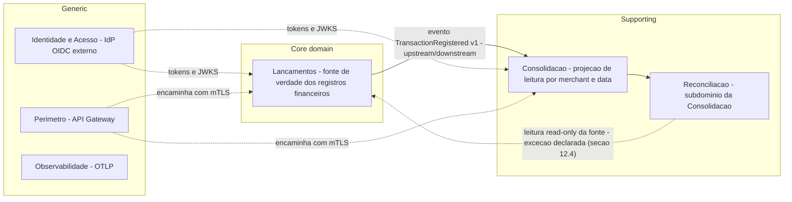
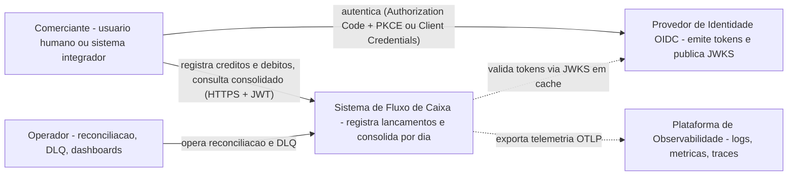
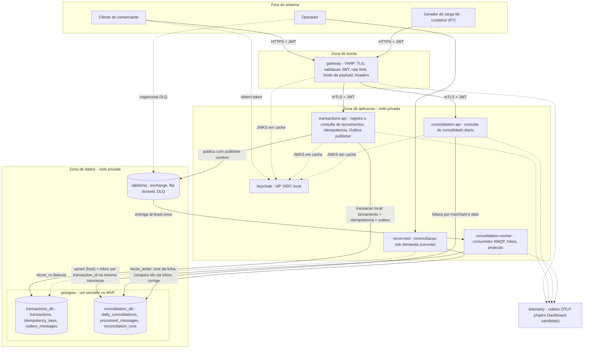
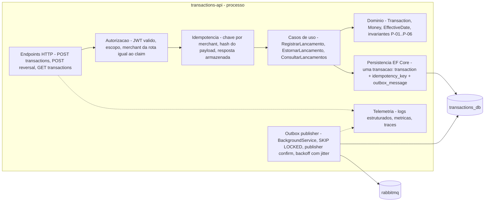
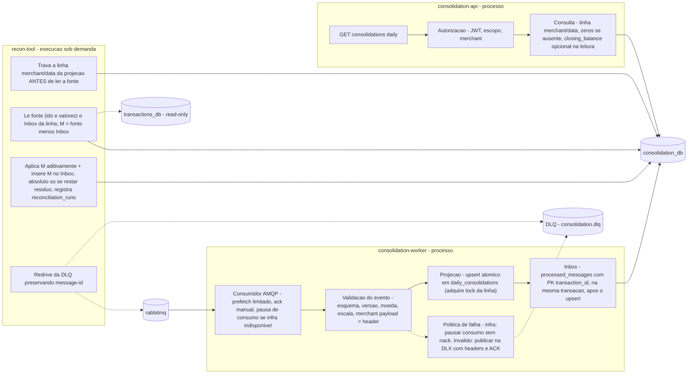
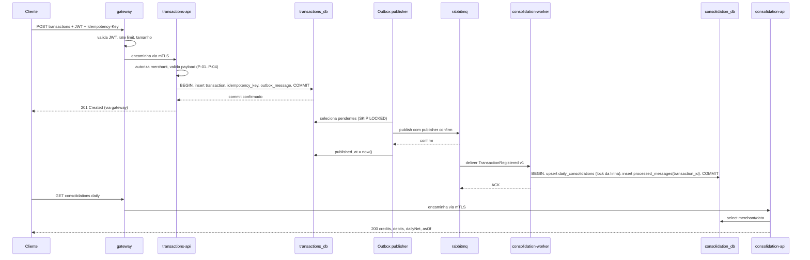
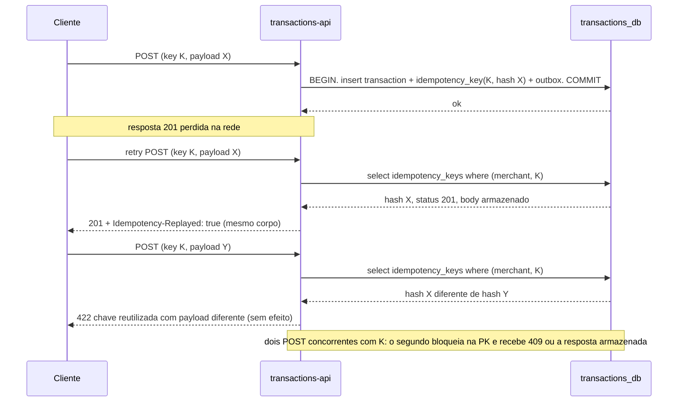
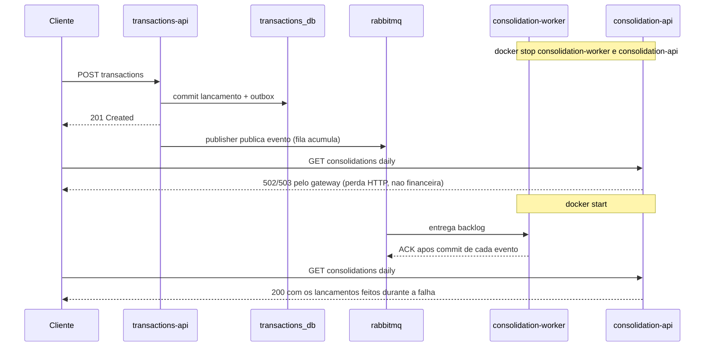
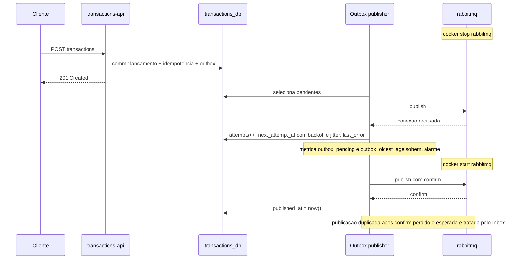

# Arquitetura-alvo — APROVADA em G1 (2026-10-29), não implementada

**Status: desenho APROVADO em G1 por Flavio Padilha Neto em 2026-10-29 (opção C; G1-10 opção b). Este documento é o desenho-alvo; rótulos MVP/ALVO/FUTURO/HIPÓTESE mantidos.** Ele descreve o desenho recomendado em F1 e aprovado em G1; DEC-01..DEC-10 foram resolvidas pelos itens G1-01..G1-08 (`docs/project/decisions-needed.md`). O que foi de fato implementado e medido em F2–F7, e o que ficou de fora, está em `implemented.md` (alvo × implementado × futuro); as evidências estão em `docs/testing/evidence-log.md`.

Legenda de rótulos usada em todo o documento:

| Rótulo | Significado |
|---|---|
| **MVP** | Proposto para o protótipo do desafio, a construir após G1 |
| **ALVO** | Proposto para produção; descrito, não construído |
| **FUTURO** | Evolução possível; fora do protótipo e do alvo imediato |
| **HIPÓTESE** | Premissa de projeto não fornecida pelo enunciado |
| **EX / B / PROP** | Origem do requisito conforme `docs/requirements/source-of-truth.md` |

---

## 0. Resumo do desenho (10 linhas)

1. Dois bounded contexts de negócio: **Lançamentos** (fonte de verdade) e **Consolidação** (projeção de leitura derivada por eventos). Identidade, perímetro e observabilidade são contextos genéricos.
2. DEC-03 decidida em G1-03: opção **C** — dois deployables HTTP (`transactions-api`, `consolidation-api`) + um worker (`consolidation-worker`), **um** servidor PostgreSQL com **dois bancos** separados por papel/credencial (seis papéis, seção 6), Outbox transacional + RabbitMQ + Inbox. Comparação em `decision-matrix.csv` e seção 2; o servidor compartilhado é dependência comum com **modo de degradação declarado** (seção 7.2a).
3. O lançamento é **confirmado** (P-07) quando a transação local que grava **lançamento + chave de idempotência + registro de outbox** faz commit; só então o cliente recebe `201`. Nenhum componente do consolidado participa dessa transação.
4. O broker, o worker, a API de consulta e o banco da projeção podem cair sem afetar o `POST`; o servidor PostgreSQL compartilhado é dependência comum declarada (seção 7).
5. Entrega *at-least-once* no transporte e **efeito idempotente** no domínio: upsert atômico da projeção (adquire o lock da linha) e Inbox (`processed_messages`, **chave `transaction_id`**) na **mesma transação**; ACK somente após commit. A reconciliação usa a **mesma identidade e a mesma ordem de locks**, por isso é segura com eventos em trânsito (seção 10.7, ADR-0002 — opção (b) aprovada em G1-10 e implementada em F4).
6. `GET` do consolidado lê **uma linha por merchant/data** (`daily_consolidations`) e devolve `credits`, `debits`, `daily_net`, `asOf`; `closing_balance` é extensão opcional calculada **na leitura** (ADR-0004), evitando recálculo em cascata.
7. Idempotência HTTP por `Idempotency-Key` com escopo **por merchant**, hash do payload e resposta armazenada (ADR-0005).
8. Multi-tenant por `merchant_id` em todas as tabelas e no token; merchant da rota deve coincidir com o claim; recurso de outro tenant responde `404` (ADR-0006).
9. Segurança corporativa: Gateway YARP (TLS, JWT, rate limit, limites), Keycloak como IdP OIDC local, mTLS Gateway→APIs no protótipo, demais canais declarados (ADR-0011, `security.md`).
10. 50 RPS e 5% de perda referem-se à **leitura** do consolidado e são HTTP, não financeiros (ADR-0009). Integridade: zero perda e zero dupla contabilização (RNF-07/08).

---

## 1. Mapa de capacidades e bounded contexts (entregável A-04)

### 1.1 Capacidades de negócio → contexto → requisito

| Capacidade de negócio | Bounded context | Tipo (DDD) | Requisitos | Classe F0 original | Classe F1 proposta (decidida em G1) |
|---|---|---|---|---|---|
| Registrar movimentação de crédito | Lançamentos | Core | RF-01 (EX) | Must | Must |
| Registrar movimentação de débito | Lançamentos | Core | RF-02 (EX) | Must | Must |
| Garantir registro único sob retry | Lançamentos | Core | RF-06, RNF-08 (PROP) | Must | Must |
| Publicar fatos financeiros confirmados | Lançamentos (Outbox) | Core | RNF-01 (EX), RNF-07 (PROP) | Must (RNF-07 mandatório no projeto) | Must |
| Estornar lançamento sem editar histórico | Lançamentos | Core | RF-08 (PROP), DEC-04 | **Could** | **Should** (fallback: projetado) — motivo: mesmo evento e mesma projeção, só endpoint + índice único |
| Consultar lançamentos do comerciante | Lançamentos | Core | RF-04 (PROP) | Should | Should |
| Projetar consolidado diário por competência | Consolidação | Supporting | RF-03 (EX), RF-07 (PROP) | RF-03 Must; RF-07 **Should** | RF-03 Must; RF-07 **Must** — motivo: com `daily_net` é apenas não rejeitar competência passada |
| Consultar consolidado diário sob pico | Consolidação | Supporting | RF-03, RF-09, RNF-02, RNF-03 (EX) | RF-03/RNF-02/03 Must; RF-09 **Should** | RF-09 **Must** — motivo: `asOf` é uma coluna já necessária à projeção |
| Reconciliar projeção com a fonte | Consolidação (subdomínio Reconciliação) | Supporting | RF-10 (PROP) | **Could** (fallback: projetado) | **Must ao menos detecção** — motivo: é a única defesa contra evento publicado-não-consumido perdido (R-09) e sustenta "RPO lógico 0" (ADR-0002); correção = opção (b) ou fallback (a) |
| Autenticar e autorizar por comerciante | Identidade e Acesso (IdP externo) + política em cada contexto | Generic | RF-05, RNF-04 (B) | Must se DEC-02 = multi-tenant | Must (DEC-02 recomendada multi-tenant) |
| Proteger o perímetro das APIs | Perímetro (Gateway) | Generic | RNF-04 (B) | Must | Must |
| Observar lag, erros, filas e latência | Observabilidade | Generic | RNF-05 (B) | Must (básico) | Must (básico) |

As diferenças entre as duas colunas são **propostas F1**, não decisões; o corte MVP construído × projetado (R-24) é item de G1 (seção 14).

### 1.2 Mapa de contextos



Relação Lançamentos → Consolidação: **Published Language** (contrato de evento versionado) com Consolidação como *conformist* do evento. Reconciliação lê a fonte apenas por ferramenta de operação com credencial read-only — exceção deliberada e declarada (seção 12.4), não integração de runtime.

### 1.3 Linguagem ubíqua (português ↔ identificadores)

| Termo | Identificador | Definição |
|---|---|---|
| Lançamento | `transaction` | Crédito ou débito de um comerciante com valor positivo, tipo, competência e instante de registro |
| Competência | `effective_date` | Data (sem hora) a que o lançamento pertence; derivada de `occurred_at` em America/Sao_Paulo quando omitida (P-03) |
| Estorno | `reversal` | Lançamento inverso que referencia o original (`reversal_of`); original permanece (P-06) |
| Consolidado diário | `daily_consolidation` | Linha por merchant/competência com `credits`, `debits`, `daily_net` |
| Saldo líquido do dia | `daily_net` | `credits − debits` da competência (definição formal em `RF.md`) |
| Saldo de fechamento | `closing_balance` | `opening_balance + Σ daily_net(d ≤ D)`; extensão condicionada a DEC-01 |
| Frescor | `asOf` | Instante do **último evento aplicado** à linha merchant/data (seção 8.2) |
| Chave de idempotência | `Idempotency-Key` | Cabeçalho do cliente, único por merchant |
| Comerciante | `merchant_id` | Tenant; UUID presente em todas as tabelas e no token |

---

## 2. Opções de runtime comparadas (DEC-03) — recomendação, não decisão

Matriz completa com pesos justificados: `docs/architecture/decision-matrix.csv`. **Horizonte pontuado nas colunas principais: ALVO E1** (alvo pequeno operado, `deployment.md` seção 3), porque é nele que complexidade operacional, custo e esforço se diferenciam de fato; a coluna `B_prototipo_E0` repontua B no horizonte **protótipo** (Compose), em que B = C + 1 container. Pesos na escala 2–5 (soma 35; máximo 175). Definição única de **A**: um host HTTP com os módulos Lançamentos e Consolidação + worker de consolidação em processo separado lendo a outbox por polling (**sem broker**) + um banco (um database, schemas por módulo). Resumo:

| Opção | Descrição | Total E1 (máx. 175) | Total sem o critério `aderencia_orientacoes_avaliador_B` (máx. 155) |
|---|---|---|---|
| **A** Monólito modular + worker | Definição acima | 125 | 113 |
| **B** Dois serviços + worker, bancos separados | `transactions-api`, `consolidation-api`, `consolidation-worker`; dois servidores de banco; Outbox + broker + Inbox | 130 (**142 no horizonte E0**) | 114 (126 em E0) |
| **C** Dois deployables + worker, um servidor de banco | Igual a B, mas **um** servidor PostgreSQL com **dois bancos** (`transactions_db`, `consolidation_db`), papéis distintos | **140** | **120** |
| **C sem broker** | C com o worker lendo `outbox_messages` em `transactions_db` por polling (papel read-only) e quarentena em tabela | 125 | 113 |

O critério `aderencia_orientacoes_avaliador_B` (antes `defensabilidade_banca`) mede aderência às orientações **documentadas** do avaliador (`source-of-truth.md`, seção B: desacoplamento entre serviços, segurança corporativa) — insumo registrado, não previsão do comportamento da banca. Como C vence também sem ele, o critério não decide a recomendação.

### 2.1 Por que não A (monólito modular)

- Em A, a consulta do consolidado (alvo de 50 RPS, RNF-02) compartilha processo, thread pool e pool de conexões com o `POST` de lançamentos. Um pico ou um defeito no módulo de consulta degrada o registro — exatamente o acoplamento que RNF-01 proíbe.
- T-04 ("parar o consolidado") só é demonstrável parcialmente: é possível parar o worker, mas não a consulta sem parar o `POST`.
- A é, porém, a opção mais barata e mais simples. **Ela venceria** no cenário S2 da sensibilidade (prazo pela metade **e** banca sem exigência de demonstração de falhas **e** baixa carga).

### 2.2 Por que não B (bancos separados) como base do alvo

- O único ganho de B sobre C é isolar o *servidor* de banco da projeção. No horizonte E1, isso dobra operação de banco (backup, HA, credenciais, monitoramento) sem requisito que o exija; é por isso que B perde para C em complexidade, custo e esforço na matriz.
- **No horizonte protótipo (E0) B supera C por 2 pontos (142 × 140):** em Compose, B é um container `postgres` a mais e uma segunda connection string. A recomendação continua C porque o protótipo deve ter a **mesma topologia do alvo** que será defendido (transferência de evidência: T-04c e T-08-com-POST valem para E1) e porque C → B é uma mudança de infraestrutura (E2, `deployment.md` seção 3), não de código. O responsável pode preferir B no protótipo para demonstrar isolamento do store; o custo é um container e um job de migração a mais, e a documentação do servidor compartilhado (7.2a) deixa de ser necessária.
- C preserva a fronteira lógica: dois **bancos** PostgreSQL distintos (não apenas schemas) impedem `JOIN` cross-context e tornam a migração para B uma mudança de *connection string*, sem alteração de código.

### 2.3 Análise de sensibilidade (cálculos a partir do CSV; pesos na escala 2–5, exceto S5, que remove um critério)

Pontuações E1 por critério (A/B/C/Csb): complexidade 5/2/3/4; isolamento 2/5/4/3; integridade 5/4/4/4; custo 5/2/4/5; esforço 4/2/3/4; testabilidade 2/5/5/3; segurança 4/3/4/4; escala 3/5/4/3; aderência 3/4/5/3. Pesos-base: 4/5/5/2/4/4/3/4/4.

| Cenário | Pesos alterados | A | B | C | C sem broker | Resultado |
|---|---|---|---|---|---|---|
| **S1** banca não exige demonstração de falhas | isolamento 5→2, testabilidade 4→2 | 115 | 105 | **118** | 110 | C ainda vence (corrige afirmação anterior de que A venceria) |
| **S2** prazo pela metade + S1 + baixa carga | complexidade 4→5, esforço 4→5, isolamento 2, testabilidade 2, escala 4→2 | **118** | 99 | 116 | 112 | **A vence**; o ADR que mudaria é o **ADR-0001** (colapsar as duas APIs em um host, manter Outbox/Inbox e worker separado, remover o broker) |
| **S3** só prazo pela metade | complexidade 5, esforço 5 | 134 | 134 | **146** | 133 | C vence (corrige a afirmação de inversão com pesos 10/8, fora da escala) |
| **S4** B supera C? | qualquer combinação na escala 2–5 | — | — | — | — | Com as pontuações E1, `B − C = w_isol + w_esc − w_compl − 2·w_custo − w_esf − w_seg − w_ader ≤ 5 + 5 − 2 − 4 − 2 − 2 − 2 = −2`: **B não supera C por pesos**. B supera C quando as **pontuações** mudam: horizonte E0 (142 × 140) ou quando o servidor compartilhado vira gargalo medido (C isolamento 4→3 e escala 4→3 → C 131; B custo relativo 2→3 → B 132) |
| **S5** sem o critério de aderência | peso 4→0 (soma 31) | 113 | 114 (126 em E0) | **120** | 113 | C vence; critério não é decisivo |

- **Componente dispensável sob menor carga:** o broker. Sem ele (`C_sem_broker`, 125), o `consolidation-worker` leria `outbox_messages` por polling em `transactions_db` (acoplamento de leitura ao schema da fonte, carga de polling sobre o banco da fonte) e a DLQ viraria tabela de quarentena. Mantém-se o broker no MVP porque (i) a orientação B do avaliador pede desacoplamento entre serviços, (ii) as falhas "broker parado" e "payload inválido → DLQ" constam dos cenários de falha a provar (origem: guias do repositório, não exigência da banca), (iii) o custo local é um container.

### 2.4 Recomendação F1 (condicionada)

Recomenda-se **C** para o protótipo e como base do alvo, **condicionada** a: (1) o responsável aprovar DEC-03, ciente de que B vence por 2 pontos no horizonte E0 e de que B é a evolução E2; (2) o servidor PostgreSQL compartilhado ser declarado como dependência comum **com modo de degradação** (7.2a) em toda a documentação e defesa; (3) os dois bancos usarem papéis distintos com privilégio mínimo e orçamento de conexões; (4) a separação de servidores (B) permanecer como ALVO opcional por escala. **Nenhuma dessas condições está aprovada.**

---

## 3. C4 L1 — Contexto (PROPOSTO)



---

## 4. C4 L2 — Contêineres do protótipo (MVP, PROPOSTO)



Notas:

- **Publisher da Outbox** é um `BackgroundService` dentro de `transactions-api` (MVP). Reserva lotes por **lease** (`locked_until`, `locked_by`) com `FOR UPDATE SKIP LOCKED` em transação curta, **publica fora da transação** com `mandatory = true` e timeout por mensagem que cobre a **chamada de publicação** (`connection.blocked`) e o confirm (HIPÓTESE 5 s), com lote dimensionado para caber no lease (`lote × timeout < lease`: 5 × 5 s = 25 s < 30 s; para de publicar ao se aproximar de `locked_until`), e usa **pool de conexões dedicado** (HIPÓTESE 2) para que broker parado ou pausado não prenda conexões do caminho do `POST` (ADR-0002 item 2). Separar em processo próprio é ALVO opcional, só se o volume de publicação competir com o `POST`.
- **Migrações** são dois jobs one-shot, um por banco (`migrations-tx`, `migrations-cons`), para que a `transactions-api` não dependa da migração do banco do consolidado (`deployment.md` 1.2).
- **Consumidor** roda em processo próprio (`consolidation-worker`) para que o número de consumidores não acompanhe o número de réplicas da API de consulta e para que T-10 (matar o consumidor em janela controlada) seja executável com `docker kill`. Hospedá-lo dentro de `consolidation-api` é simplificação aceitável se o prazo apertar (ADR-0001).
- **Diferenças do ALVO** em relação a este L2: réplicas por processo, PostgreSQL gerenciado com HA (opcionalmente dois servidores), broker em cluster, WAF/LB antes do gateway, IdP corporativo, PKI gerenciada. Ver `deployment.md`.

---

## 5. C4 L3 — Componentes (PROPOSTO)

### 5.1 Contexto Lançamentos (`transactions-api`)



| Componente | Responsabilidade | Requisito/ameaça que o justifica |
|---|---|---|
| Endpoints HTTP | Contrato REST, Problem Details, limites de tamanho | RF-01/02/04/08 |
| Autorização | Validar JWT (issuer, audience, assinatura, exp/nbf, escopo) e igualdade merchant rota × claim | RF-05, RNF-04, STRIDE S/E/I |
| Idempotência | Localizar `(merchant_id, key)`; comparar hash; devolver resposta armazenada ou `409/422` | RF-06, RNF-08 |
| Casos de uso | Orquestrar validação, persistência e outbox; sem lógica de consolidação | RF-01/02/08 |
| Domínio | `Money` decimal escala 2, `amount > 0`, tipo CREDIT/DEBIT, competência válida e não futura, estorno único | P-01..P-06, P-09, STRIDE T |
| Persistência | Transação única com três inserts; `synchronous_commit = on` | P-07, RNF-07 |
| Outbox publisher | Publicar pendentes com confirmação do broker; marcar `published_at`; backoff; métricas de backlog | RNF-01, RNF-07, falha 2 |
| Telemetria | Correlation/trace id, sem valores nem PII em log | RNF-05, STRIDE R |

### 5.2 Contexto Consolidação (`consolidation-worker`, `consolidation-api`, `recon-tool`)



| Componente | Responsabilidade | Requisito/ameaça que o justifica |
|---|---|---|
| Consumidor AMQP | Consumir `consolidation.transaction-registered` com `prefetch` limitado e ACK manual após commit; **pausar o consumo** (sem ACK/NACK) enquanto `consolidation_db` estiver indisponível, retomando por sondagem | RNF-07, RNF-01 ("após o retorno"), falha 3 |
| Validação do evento | Rejeitar esquema/versão desconhecidos, moeda ≠ BRL, escala > 2, merchant ausente ou `merchantId` do payload ≠ header AMQP | STRIDE T, falha 4 |
| Projeção | `INSERT ... ON CONFLICT (merchant_id, effective_date) DO UPDATE` somando créditos/débitos; atualiza `last_applied_at`; executado **antes** do Inbox para que a linha seja o único ponto de serialização compartilhado com a reconciliação | RF-03, RF-07, T-06, T-14b |
| Inbox | `INSERT ... ON CONFLICT (transaction_id) DO NOTHING RETURNING` em `processed_messages`; zero linhas = já aplicado → `ROLLBACK` + ACK sem efeito | RNF-08, T-03, T-10, T-14a |
| Política de falha | Infraestrutura indisponível: pausar consumo, **não** consome `x-delivery-limit`; mensagem inválida: publicar na `cashflow.dlx` com `x-reason` e `message-id` preservados, depois ACK; `x-delivery-limit` só como rede de segurança para crash loop; nada é descartado | falha 4, RNF-05, R-12 |
| GET consolidations | Contrato de leitura; `0,00` para data sem movimento (P-08); `closing_balance` opcional | RF-03, RF-09, RNF-02/03/09 |
| Reconciliação | Por linha: lock → ler fonte → ler Inbox → aplicar ausentes aditivamente e inseri-los no Inbox → absoluto só com resíduo → `reconciliation_runs`; **modo reconstrução** apaga Inbox da linha e reaplica da fonte sob o mesmo lock; idempotente e segura com eventos em trânsito (ADR-0002 item 7; opção (b) aprovada em G1-10 e implementada em F4) | RF-10, RNF-07, RNF-08, falha 5, T-14a/b |
| Redrive da DLQ | Publicar mensagem **nova** no exchange principal (`mandatory = true`, confirm) preservando `message-id` e payload e removendo `x-death`/`x-delivery-count`/headers da DLX; recusar `occurred_at` fora da retenção do Inbox (usar `rebuild`); registrar `dlq_redrive` em `reconciliation_runs` antes de publicar | R-12, R-13, T-13, T-29 |

---

## 6. Tabela por componente — MVP × ALVO × FUTURO

| Componente | MVP (protótipo, após G1) | ALVO (produção, descrito) | FUTURO | Requisito que o justifica |
|---|---|---|---|---|
| `gateway` (YARP) | 1 instância; TLS com certificado de desenvolvimento; JWT; rate limit; limite de payload; headers; mTLS para as APIs | ≥ 2 réplicas atrás de LB/WAF; certificado público; limites por tenant | Gateway gerenciado do provedor | RNF-04 (B), RNF-02/03 |
| `transactions-api` | 1 instância; EF Core; Outbox publisher embutido | ≥ 2 réplicas; publisher com `SKIP LOCKED`; autoscaling por CPU/latência | Publisher em processo próprio se competir com o POST | RF-01/02/04/06/08, RNF-01/07/08 |
| `consolidation-api` | 1 instância (ou 2 para demonstrar escala horizontal em T-08); Npgsql `Maximum Pool Size` **12 por instância** (2 × 12 = 24 ≤ `cons_ro` `CONNECTION LIMIT 25`, 7.2a) | ≥ 2 réplicas (recalcular `pool × réplicas ≤ limite do papel`); cache HTTP curto opcional (`Cache-Control: private, max-age` ≤ lag aceito) | Réplica de leitura do banco | RF-03/09, RNF-02/03/09 |
| `consolidation-worker` | 1 instância; `prefetch` 16 (HIPÓTESE) | 1–N instâncias; competing consumers com Inbox | Particionamento por merchant se ordenação for exigida | RF-03/07, RNF-07/08 |
| `recon-tool` | Console executado sob demanda (`docker compose run`); papel `recon_ro` em `transactions_db` + `recon_writer` em `consolidation_db`; subcomandos `reconcile`, `rebuild`, `dlq redrive` | Job agendado; relatório e alarme | Endpoint interno de totais e ids na `transactions-api` (Client Credentials + mTLS) substituindo o acesso cross-DB | RF-10, R-12 |
| `postgres` | 1 servidor, 2 bancos, **6 papéis** (`tx_app`, `cons_ro`, `cons_worker`, `recon_ro`, `recon_writer`, `migrator`) com `CONNECTION LIMIT` por papel e `REVOKE CONNECT ... FROM PUBLIC`; `statement_timeout`/`lock_timeout` nos papéis do consolidado; sem TLS (gap declarado) | PostgreSQL gerenciado, HA multi-zona, backup + PITR, TLS `verify-full`, `pg_hba` por banco/papel | Dois servidores (opção B) se escala/isolamento exigir | RNF-01/07/12, R-14 |
| `rabbitmq` | 1 nó; fila durável (quorum queue); DLX/DLQ; usuários por serviço — **divergência na implementação (F6, C-22 em `decisions-needed.md`):** um usuário de aplicação compartilhado (sem tag, permissões mínimas) + um de operação opcional; usuários por serviço passam a alvo de produção (`deployment.md` §8); sem TLS (gap declarado) | Cluster 3 nós, quorum queues, AMQPS, usuários/vhost por serviço | Broker gerenciado | RNF-01/07, falhas 2 e 4 |
| `keycloak` | 1 nó em modo dev; realm importado sem segredos reais; HTTP interno (gap declarado) | IdP corporativo (Keycloak HA ou gerenciado), HTTPS, rotação de chaves | Federação, MFA | RNF-04 (B), DEC-06 |
| `telemetry` | 1 container OTLP (Aspire Dashboard candidato) | Coletor OTel + backends gerenciados; retenção e alertas | SLOs e error budget | RNF-05 (B) |
| PKI local | Script gera CA + certificados de servidor e cliente em diretório ignorado pelo Git | Gestor de certificados com rotação automática | SPIFFE/mesh | DEC-07 |
| Migrações | **Dois** jobs one-shot (`migrations-tx`, `migrations-cons`), um por banco, com papel `migrator`; cada API depende só do job do seu banco (expand-contract) | Etapa do pipeline, nunca no start com múltiplas réplicas | — | RNF-06, RNF-01 |
| k6 | Container sob demanda (k6 não instalado no host) | Pipeline de performance | — | RNF-02/03, T-08 |

---

## 7. RNF-01: componentes exclusivos, compartilhados e ponto de confirmação

### 7.1 Enumeração (exigida por A-08; depende de DEC-03 = C)

| Classe | Componentes | Efeito da falha sobre `POST /transactions` | Efeito sobre o consolidado | Teste |
|---|---|---|---|---|
| **Exclusivos do consolidado** (podem cair sem afetar o POST) | `consolidation-api`; `consolidation-worker`; `rabbitmq` (exchange, fila, DLQ); banco `consolidation_db` (as tabelas, não o servidor); `recon-tool` | **Nenhum na transação nem na resposta** do POST. Para `consolidation_db`: **nenhum efeito direto; degradação possível por recursos compartilhados do servidor** (conexões, CPU/I-O/WAL, disco) — ver 7.2a e R-14 | `GET` indisponível (API) ou defasado (worker/broker); lag e backlog da outbox sobem; alarmes | T-04 (API/worker), T-04c (`consolidation_db` indisponível), T-05/T-05b (broker parado/pausado) |
| **Compartilhados** (falha afeta os dois) | Servidor `postgres` (MVP); `gateway`; `keycloak` (emissão de novos tokens; **cold start** do gateway/APIs sem JWKS); rede; `telemetry` (não deve bloquear: exportação assíncrona com fila limitada) | POST falha se o servidor de banco ou o gateway caírem; tokens já emitidos continuam válidos com IdP fora **em processo já aquecido** | Idem | **Não coberto por T-04/T-05**; declarado como limite; T-08-com-POST mede a interferência |
| **Exclusivos de lançamentos** | `transactions-api` (inclui publisher); banco `transactions_db` | POST falha | Consolidado continua respondendo com o último estado aplicado | — |

**Afirmação a defender:** a queda do servidor PostgreSQL derruba o `POST` **em qualquer topologia** (também em B, pois `transactions_db` é a fonte). O desacoplamento de RNF-01 trata do consolidado, não elimina esse SPOF; a mitigação é HA do banco (ALVO). O que **é** específico de C é a **degradação** por disputa de recursos no servidor compartilhado, tratada a seguir.

### 7.2a Modo de degradação do servidor PostgreSQL compartilhado (opção C) — PROPOSTO

| Recurso disputado | Como o consolidado pode afetar o `POST` | Mitigação MVP (HIPÓTESES numéricas) | Evidência |
|---|---|---|---|
| **Conexões** (`max_connections` padrão 100; Npgsql `Maximum Pool Size` padrão 100 **por processo**) | `consolidation-api` a 50 RPS + worker + recon podem esgotar o servidor e o `POST` recebe `53300 too_many_connections` → `500` | Orçamento que fecha em `max_connections = 100`: `superuser_reserved_connections = 3`; `ALTER ROLE tx_app CONNECTION LIMIT 40` (**reserva do registro**); `cons_ro 25`; `cons_worker 8`; `recon_writer 3`; `recon_ro 3`; `migrator 2` (limites dos papéis = 81; + 3 reservadas = 84; folga 16). Regra: `Max Pool Size × instâncias do processo` **≤** limite do papel (tx 40 → pool 30 + publisher 2, 1 instância; cons-api **12 por instância** → 2 instâncias em T-08 = 24 ≤ 25; worker 6; recon 2). `ALTER DATABASE consolidation_db CONNECTION LIMIT 40`. `REVOKE CONNECT ON DATABASE transactions_db, consolidation_db FROM PUBLIC`; `pg_hba` por banco/papel (P2) | **T-04c** (abaixo); **T-08 com `POST` concorrente** (RNF-01: taxa de sucesso do `POST` durante 50 RPS de leitura) |
| **CPU / I-O / WAL** | Consultas lentas ou upserts em massa do worker atrasam o commit do `POST` | `statement_timeout` **só** nos papéis do consolidado (`cons_ro 2 s`, `cons_worker 10 s`, `recon_* 60 s`), `lock_timeout` (`cons_worker 5 s`, `recon_writer 2 s`), `idle_in_transaction_session_timeout 30 s` em todos os papéis do consolidado; coerência worker × recon: o recon lê a fonte **sob o lock** em transação curta na conexão `recon_ro` (`BEGIN; SET LOCAL statement_timeout = '3s'; SELECT; COMMIT`) e meta de posse < 5 s por linha (os 60 s do papel ficam para a varredura fora do lock), e o worker trata `55P03`/`40P01` como transiente com retry em processo sem NACK (ADR-0002 itens 5 e 7); `GET` lê uma linha por PK; worker `prefetch` 16 limita o paralelismo | T-08-com-POST (p95 do `POST` antes/durante) |
| **Disco** (outbox crescendo com broker fora; Inbox; WAL) | Disco cheio derruba commits dos dois bancos | Estimativa: ~1,5 KB/lançamento → 10 k lançamentos/dia ≈ 15 MB/dia de outbox pendente; alarmes `outbox_pending`, `outbox_oldest_age_seconds`, espaço em disco; limpeza por retenção (R-27) | T-05 prolongado + métrica de disco |
| **Reinícios / manutenção** | Reinício do servidor derruba os dois (SPOF já declarado) | HA gerenciada (ALVO); no MVP, declarar | — |

**Teste T-04c (proposto):** `ALTER DATABASE consolidation_db ALLOW_CONNECTIONS false` + `pg_terminate_backend` dos backends `cons_*` enquanto o `POST` roda a taxa constante → taxa de sucesso do `POST` inalterada; `GET` → 5xx; worker pausa o consumo (ADR-0002 item 5) sem mandar nada à DLQ; `ALLOW_CONNECTIONS true` → backlog aplicado. É o equivalente lógico, em C, de "parar o store da projeção" de B.

### 7.2 O que muda quando cada peça cai

| Peça | Registro (`POST`) | Consulta (`GET`) | Integridade | Observável |
|---|---|---|---|---|
| `consolidation-api` | OK | `502/503` no gateway | Intacta | 5xx na rota de consulta |
| `consolidation-worker` | OK | OK, mas `asOf` para de avançar | Intacta; backlog na fila | Lag de consolidação ↑, fila ↑ |
| `rabbitmq` | OK (`201`) | OK, defasado | Intacta; eventos ficam em `outbox_messages` | Outbox pendente ↑, idade do mais antigo ↑, publisher em backoff |
| `transactions-api` | Falha (`502/503`) | OK | Intacta (nada confirmado se perdeu) | 5xx na rota de registro |
| Servidor `postgres` | Falha | Falha | Intacta (nenhum `201` sem commit) | 5xx em ambas |
| `keycloak` | OK com token válido em cache de JWKS; novos logins falham | Idem | Intacta | Erros de emissão de token |
| `gateway` | Falha | Falha | Intacta | Indisponibilidade total externa |
| `telemetry` | OK | OK | Intacta | Perda de telemetria (exportador descarta com fila cheia) |

### 7.3 Ponto exato de confirmação (P-07)

```
BEGIN;
  INSERT INTO transactions (...);          -- lançamento
  INSERT INTO idempotency_keys (...);      -- (merchant_id, key) → hash + resposta
  INSERT INTO outbox_messages (...);       -- evento TransactionRegistered v1
COMMIT;                                     -- durável (WAL fsync, synchronous_commit = on)
→ HTTP 201 Created
```

- A resposta `201` é enviada **somente após** o `COMMIT`. Nenhuma chamada ao broker, ao worker ou à API de consulta ocorre antes do `201`.
- Falha após o `COMMIT` e antes de o cliente receber o `201` (rede): o cliente repete com a mesma `Idempotency-Key` e recebe a resposta armazenada (ADR-0005).
- **Ponto de confirmação da projeção:** `COMMIT` da transação do worker que insere em `processed_messages` e faz upsert em `daily_consolidations`; o ACK ao broker vem depois.

---

## 8. Contratos resumidos (PROPOSTO)

Base: `/api/v1`. Autenticação: `Authorization: Bearer <JWT>`. Erros em `application/problem+json`. Valores monetários como **string decimal** com 2 casas (`"100.00"`) para evitar perda de precisão em clientes JSON (P-01). Moeda `BRL` (P-02).

### 8.1 Lançamentos

| Método e rota | Escopo | Cabeçalhos | Corpo | Respostas |
|---|---|---|---|---|
| `POST /merchants/{merchantId}/transactions` | `transactions.write` | `Idempotency-Key` (obrigatório, ≤ 255 chars, recomendado UUID) | `{ "type": "CREDIT" ou "DEBIT", "amount": "100.00", "currency": "BRL", "effectiveDate": "2026-10-28" (opcional), "description": "..." (opcional, ≤ 140) }` | `201` lançamento; `201` + `Idempotency-Replayed: true` em retry igual; `400` JSON inválido; `422` validação (valor ≤ 0, > 2 casas, moeda ≠ BRL, competência futura) ou mesma chave com payload diferente; `409` mesma chave em processamento concorrente; `401/403/404/429` conforme `security.md` |
| `POST /merchants/{merchantId}/transactions/{id}/reversal` | `transactions.write` | `Idempotency-Key` | vazio ou `{ "reason": "..." }` | `201` lançamento inverso com `reversalOf`; `409` já estornado; `404` inexistente ou de outro tenant |
| `GET /merchants/{merchantId}/transactions?from=&to=&page=&pageSize=` | `transactions.read` | — | — | `200` lista paginada em ordem `(effectiveDate, occurredAt, id)`; `pageSize` ≤ 200 |
| `GET /merchants/{merchantId}/transactions/{id}` | `transactions.read` | — | — | `200`; `404` |

Representação do lançamento: `{ "id", "merchantId", "type", "amount", "currency", "effectiveDate", "occurredAt", "reversalOf", "createdAt" }`. `occurredAt` é atribuído pelo servidor (P-03).

### 8.2 Consolidado

| Método e rota | Escopo | Resposta |
|---|---|---|
| `GET /merchants/{merchantId}/consolidations/daily?date=YYYY-MM-DD` | `consolidation.read` | `200 { "merchantId", "date", "currency": "BRL", "credits": "100.00", "debits": "35.20", "dailyNet": "64.80", "entriesCount": 2, "asOf": "2026-10-28T13:05:07Z" }`. Data sem movimento: zeros, `entriesCount: 0`, `asOf: null` (P-08). |
| `... &include=closingBalance` (extensão condicionada a DEC-01) | `consolidation.read` | Acrescenta `"closingBalance"` e `"openingBalanceAssumption": "ZERO_AT_FIRST_DATE"` (HIPÓTESE). Calculado na leitura como `Σ dailyNet(d ≤ date)`, sem materialização (ADR-0004). Oráculo (abertura 0): dia 1 `dailyNet 64,80` → `closingBalance "64.80"`; dia 2 `dailyNet 10,00` → `closingBalance "74.80"`; após retroativo de 5,00 no dia 1 → `"79.80"` no dia 2. O exemplo anterior juntava `74.80` ao `dailyNet` do dia 1 (incoerente). |
| `GET /merchants/{merchantId}/consolidations/daily?from=&to=` (Could) | `consolidation.read` | Lista de dias com os mesmos campos; dias sem linha preenchidos com zeros. |

**Semântica de `asOf`:** instante (`occurred_at`) do **último evento aplicado** à linha merchant/data. Não garante que todos os eventos anteriores a esse instante foram aplicados (entrega sem ordenação garantida); garante que a linha reflete tudo que o worker já aplicou. A diferença `now − asOf` para linhas com backlog é o **lag** exposto em métrica, não no contrato.

### 8.3 Evento `TransactionRegistered` v1 (Published Language)

| Campo | Tipo | Observação |
|---|---|---|
| `eventId` | UUID | = `outbox_messages.id`; usado para rastreio (`message-id`, DLQ, redrive). **Não** é a chave do Inbox: o Inbox usa `transactionId` (ADR-0002 item 4), com o invariante de um evento por lançamento |
| `type` / `version` | string / int | `TransactionRegistered` / `1` (header AMQP `type`, routing key `transaction.registered.v1`) |
| `occurredAt` | timestamp UTC | Do lançamento |
| `merchantId`, `transactionId` | UUID | — |
| `entryType` | `CREDIT`/`DEBIT` | — |
| `amount` | string decimal escala 2 | Nunca float |
| `currency` | `BRL` | — |
| `effectiveDate` | date | Competência |
| `reversalOf` | UUID ou null | Estorno é evento comum com tipo inverso (ADR-0007) |
| Headers | `message-id`, `traceparent`, `merchant_id`, `content-type` | Propagação de trace |

Topologia AMQP (HIPÓTESE), **declarada pela infraestrutura** (`definitions.json`) antes do publisher: exchange `cashflow.transactions` (topic, durável) → fila `consolidation.transaction-registered` (quorum queue, durável) com `x-dead-letter-exchange = cashflow.dlx` → fila `consolidation.dlq`. Publicação com `mandatory = true`; `basic.return` (sem rota) = falha de publicação, não confirmação (ADR-0002 item 2). Sem `x-max-length`/`drop-head`. `x-delivery-limit` (HIPÓTESE 5) é **rede de segurança** para mensagem que derruba o worker, não o caminho normal de falha transiente (que pausa o consumo) nem de mensagem inválida (publicada na DLX com headers e ACK). Redrive da DLQ preserva `message-id`.

---

## 9. Modelo de dados lógico (PROPOSTO)

### 9.1 `transactions_db` (role `tx_app`)

| Tabela | Colunas principais | Chaves e índices | Regras |
|---|---|---|---|
| `transactions` | `id uuid`, `merchant_id uuid`, `entry_type smallint`, `amount numeric(18,2)`, `currency char(3)`, `effective_date date`, `occurred_at timestamptz`, `description varchar(140)`, `reversal_of uuid null`, **`created_by_sub varchar(255)`, `created_by_client_id varchar(255)`** (não repúdio: `sub`/`azp` do token que registrou o lançamento ou o estorno), `created_at timestamptz` | PK `id`; índice `(merchant_id, effective_date, occurred_at, id)`; **unique parcial** `(reversal_of) WHERE reversal_of IS NOT NULL`; FK `reversal_of → transactions.id` (variante composta `(merchant_id, id)` registrada em 14.1) | `CHECK amount > 0`; `CHECK currency = 'BRL'` (MVP); escala validada na aplicação antes do insert (numeric arredondaria silenciosamente); linhas imutáveis (P-06) |
| `idempotency_keys` | `merchant_id uuid`, `idempotency_key varchar(255)`, `request_hash char(64)`, `transaction_id uuid`, `response_status smallint`, `response_body jsonb`, `created_at`, `expires_at` | PK `(merchant_id, idempotency_key)` | Retenção 7 dias (HIPÓTESE); limpeza por job |
| `outbox_messages` | `id uuid`, `merchant_id uuid`, `aggregate_id uuid` (= `transaction_id`), `type varchar`, `version int`, `payload jsonb`, `headers jsonb`, `occurred_at`, `published_at null`, `attempts int`, `next_attempt_at`, `last_error text`, **`locked_until timestamptz null`, `locked_by varchar(64) null`** (lease do publisher) | PK `id`; **unique `(aggregate_id, type, version)`** (um evento por lançamento); índice parcial `(next_attempt_at) WHERE published_at IS NULL` | Publicadas retidas 7 dias (HIPÓTESE) para replay técnico; depois arquivadas/removidas. **Não** é fonte de reconstrução (ADR-0002 item 6) |

### 9.2 `consolidation_db` (papéis `cons_ro` SELECT, `cons_worker` DML, `recon_writer` DML; `recon_ro` só leitura em `transactions_db`)

| Tabela | Colunas principais | Chaves e índices | Regras |
|---|---|---|---|
| `daily_consolidations` | `merchant_id uuid`, `effective_date date`, `credits numeric(18,2)`, `debits numeric(18,2)`, `entries_count int`, `last_applied_at timestamptz`, `updated_at` | PK `(merchant_id, effective_date)` | `daily_net = credits − debits` calculado na leitura (ou coluna gerada); upsert atômico `ON CONFLICT DO UPDATE SET credits = credits + EXCLUDED.credits ...` executado **antes** do insert no Inbox; a linha é o ponto de serialização entre worker e reconciliação |
| `processed_messages` | **`transaction_id uuid`** (chave), `event_id uuid null` (nulo nas linhas inseridas pelo `recon-tool`), `merchant_id uuid`, **`effective_date date`**, `consumer varchar(64)` (`worker` ou `recon-tool`), `processed_at` | PK `(transaction_id)` (ou `(consumer, transaction_id)` se houver mais consumidores); índice `(merchant_id, effective_date)` para a reconciliação por linha; índice `(processed_at)` para o expurgo | Retenção 30 dias (HIPÓTESE) > janela de reentrega/replay/DLQ (7 d); expurgo por `processed_at` além de 30 d **+ margem 1 d** (HIPÓTESE) sem lock da linha, seguro pelas regras de obsolescência a 30 d ou menos (worker `stale`, redrive recusado, guarda do recon aos 29 d); faixas com Inbox expurgado só por **modo reconstrução**; ver R-13/R-40 e decisão de retenção em G1-13 (ADR-0002 item 8) |
| `reconciliation_runs` | `id`, `started_at`, `finished_at`, `merchant_id` (obrigatório; execução multi-merchant gera uma linha por merchant), `from_date`, `to_date`, `divergences int`, `kinds jsonb` (`catch_up`, `corrected_corruption`, `anomaly`, `out_of_retention`, `rebuild`, `dlq_redrive`; linhas abortadas registradas em transação própria após o `ROLLBACK`), `details jsonb` | PK `id` | Trilha operacional de RF-10 e das operações de DLQ |
| `merchant_opening_balances` (FUTURO) | `merchant_id`, `opening_date`, `opening_amount` | PK `merchant_id` | Só se `closing_balance` deixar de assumir abertura 0 |

Todas as tabelas têm `merchant_id`. As **APIs** filtram por `merchant_id` do token; o **worker** filtra pelo `merchant_id` do evento (validado contra o header AMQP); o **recon-tool** pelo parâmetro de execução, registrado em `reconciliation_runs`. Row-Level Security do PostgreSQL é defesa em profundidade **ALVO**, não MVP (ADR-0006).

---

## 10. Diagramas de sequência (PROPOSTO)

Convenção: cada diagrama declara o **invariante preservado** e o **teste** que o evidenciará (teste existe só quando escrito; validação só quando executado).

### 10.1 Caminho feliz

Invariante: `201` só após commit durável; consolidado converge sem dupla contabilização. Testes: T-01, T-02.



### 10.2 Retry HTTP idempotente

Invariante: mesma chave + mesmo payload → um único lançamento e a mesma resposta; mesma chave + payload diferente → `422` sem efeito. Teste: T-03 (parte HTTP).



### 10.3 Falha 1 — Consolidado parado (API de consulta e/ou worker)

Invariante: taxa de sucesso do `POST` inalterada; lançamentos feitos durante a falha aparecem no consolidado após o retorno. Teste: T-04.



### 10.4 Falha 2 — Broker parado

Invariante: `POST` não depende do publish; nenhum evento se perde (fica em `outbox_messages`); lag e backlog visíveis. Teste: T-05.



### 10.5 Falha 3 — Consumidor cai após commit e antes do ACK

Invariante: reentrega reconhecida como já aplicada; projeção não duplica. Teste: T-10 (e T-03, parte de redelivery).

```mermaid
sequenceDiagram
    participant Q as rabbitmq
    participant W as consolidation-worker
    participant D2 as consolidation_db
    Q->>W: deliver evento E (transaction T, delivery 1)
    W->>D2: BEGIN. upsert daily_consolidations (lock). insert processed_messages(T). COMMIT
    Note over W: docker kill antes do ACK (ponto de injecao controlado)
    Q->>Q: mensagem volta a ready (sem ACK)
    Note over W: reinicio do worker
    Q->>W: deliver evento E (delivery 2)
    W->>D2: BEGIN. upsert daily_consolidations (lock). insert processed_messages(T) ON CONFLICT DO NOTHING RETURNING
    D2-->>W: zero linhas (T ja processado)
    W->>D2: ROLLBACK (desfaz o upsert; nenhuma alteracao)
    W-->>Q: ACK (efeito ja aplicado)
    Note over D2: daily_consolidations inalterada. metrica inbox_duplicates_total++
```

### 10.6 Falha 4 — Payload inválido → DLQ

Invariante: nenhuma mensagem é descartada silenciosamente; projeção não é alterada por dado inválido; quarentena auditável; **indisponibilidade de infraestrutura nunca manda mensagem válida à DLQ**. Teste: **lacuna de plano** — não havia T-xx no playbook de testes; proposto **T-13** (seção 13).

```mermaid
sequenceDiagram
    participant Q as rabbitmq
    participant W as consolidation-worker
    participant X as cashflow.dlx
    participant L as consolidation.dlq
    participant O as Operador
    Q->>W: deliver mensagem M (schema invalido ou moeda nao BRL)
    W->>W: validacao falha (mensagem invalida)
    W->>X: publish M na DLX com mandatory=true e headers x-reason, x-original-routing-key, message-id preservado (confirm)
    X->>L: enfileira M
    W-->>Q: ACK da original (apos confirm da DLX. basic.return ou timeout = sem ACK, pausa)
    Note over W: log estruturado sem valores. metrica dlq_messages_total{reason}++
    O->>L: inspeciona, corrige produtor, registra dlq_redrive em reconciliation_runs e redriva como mensagem NOVA (message-id e payload iguais, sem x-death e x-delivery-count) ou registra decisao
    Note over Q,W: infra indisponivel (consolidation_db fora): sem ACK e sem NACK. worker pausa com basic.cancel no mesmo canal (nunca fecha o canal), sonda o banco e retoma. x-delivery-limit nao e consumido. 55P03 e 40P01 = retry em processo
    Note over Q,W: limite declarado: consumer_timeout do broker (30 min) fecha o canal e devolve as entregas a fila contando 1. banco fora por mais de 5 x 30 min manda mensagens validas a DLQ com x-death. redrive apos recuperacao. zero perda
    Note over Q,L: x-delivery-limit (5) e rede de seguranca para mensagem que derruba o worker ou pausa alem do consumer_timeout. chega a DLQ com x-death e sem x-reason. nunca descartada. mensagem com occurred_at fora da retencao do Inbox vai a DLQ como x-reason=stale e so se corrige por rebuild
```



### 10.7 Falha 5 — Replay e reconciliação

Invariante: reprocessar eventos não altera a projeção (Inbox); divergência fonte × projeção é detectada e corrigida **sem dupla contabilização mesmo com eventos em trânsito** (mesma identidade `transaction_id` e mesma ordem de locks que o worker); executar duas vezes produz o mesmo resultado. Testes: T-09, T-10, **T-14a/T-14b (propostos)** e aceite de RF-10. Entre (a) detectar / (b) corrigir idempotente / (c) quiescência, G1-10 aprovou **(b)**, implementada em F4 (ADR-0002); o diagrama mostra (b).

```mermaid
sequenceDiagram
    participant O as Operador
    participant P as Outbox publisher (modo replay)
    participant Q as rabbitmq
    participant W as consolidation-worker
    participant D2 as consolidation_db
    participant RT as recon-tool (recon_writer)
    participant D1 as transactions_db (recon_ro)
    O->>P: replay outbox (merchant, intervalo de occurred_at) - teste de dedupe, nao reconstrucao
    P->>Q: republica eventos ja publicados
    Q->>W: deliver (duplicatas)
    W->>D2: upsert (lock). insert processed_messages(T) devolve zero linhas. ROLLBACK. ACK sem efeito
    Note over D2: projecao inalterada apos replay
    O->>RT: reconciliar (merchant, intervalo de effective_date)
    loop para cada (merchant, effective_date)
        RT->>D2: BEGIN (READ COMMITTED). upsert linha se ausente. SELECT ... FOR UPDATE (lock ANTES de ler a fonte; lock_timeout 2 s)
        RT->>D1: S = ids, tipos, valores e occurred_at com essa effective_date (transacao curta com SET LOCAL statement_timeout 3 s. posse da linha menor que 5 s)
        RT->>D2: I = transaction_ids do Inbox dessa linha
        RT->>RT: M = S menos I. E = I menos S (deve ser vazio)
        RT->>D2: se min(occurred_at de S) fora da retencao do Inbox: ROLLBACK da linha. nada mais roda. registra kind out_of_retention em transacao propria (usar rebuild)
        RT->>D2: senao insert M no Inbox (ON CONFLICT DO NOTHING RETURNING. zero linhas = anomaly = ROLLBACK + registro em transacao propria) + soma aditiva de M na linha (kind catch_up)
        RT->>D2: se E nao vazio: ROLLBACK da linha + registro anomaly em transacao propria. absoluto nao roda
        RT->>D2: so se os passos anteriores concluiram: se ainda credits/debits != soma(S): grava absoluto soma(S) (kind corrected_corruption)
        RT->>D2: insert reconciliation_runs na mesma transacao. COMMIT
    end
    RT-->>O: relatorio por kind. segunda execucao: 0 divergencias
    Note over W,RT: evento em transito de T em S: worker espera o lock, encontra T no Inbox, ROLLBACK + ACK. evento de T fora de S (confirmado apos a leitura): aplicado normalmente
    Note over RT: modo reconstrucao: sob o mesmo lock, DELETE Inbox da linha, zera, reinsere todos os ids de S e grava soma(S)
```

Reproduções do defeito corrigido (ADR-0002, contexto): (i) broker parado → `POST 100,00` → recon → broker volta → resultado **`100,00`**, não `200,00`; (ii) retroativo `5,00` aplicado pelo worker durante a reconciliação → resultado **`69,80`**, não `64,80`.

---

## 11. Consistência, concorrência e frescor

- **Garantia oferecida:** *at-least-once delivery* no transporte + *idempotent effect* no domínio. Não se promete *exactly-once* de transporte.
- **Concorrência na projeção** (T-06): o upsert `ON CONFLICT DO UPDATE SET credits = daily_consolidations.credits + EXCLUDED.credits` é atômico por linha; não há read-modify-write na aplicação. Dois workers aplicando eventos distintos do mesmo merchant/data serializam no lock da linha. **Ordem de locks única** para worker e reconciliação: (1) linha de `daily_consolidations`, (2) índice único de `processed_messages`. O worker faz upsert → Inbox; o recon faz lock → fonte → Inbox → correção. Nunca o inverso, para evitar deadlock entre o lock da linha e o índice do Inbox (ADR-0002 itens 4 e 7). Worker e recon em `READ COMMITTED`, uma transação por evento/linha; o worker trata `55P03` (`lock_timeout`) e `40P01` (deadlock, vítima escolhida pelo PostgreSQL) como transientes com retry em processo, sem NACK; o recon mantém o lock por menos de 5 s por linha (leitura da fonte com `statement_timeout` 3 s sob o lock) para que o worker (`lock_timeout` 5 s) raramente precise do retry.
- **Ordenação:** não exigida. Somas comutam; estorno é evento de sinal oposto. `asOf` definido como último evento aplicado (seção 8.2).
- **Frescor:** SLO de lag (PROP) `p95 < 5 s` em estado saudável; métrica `consolidation_lag_seconds` = `now − occurred_at` no momento da aplicação. Não se promete consistência forte entre `201` e `GET`.
- **Retroativos:** afetam apenas a linha da competência (`daily_net`); `closing_balance` calculado na leitura absorve o efeito sem recálculo materializado (ADR-0004, ADR-0007).

## 12. Decisões transversais resumidas

### 12.1 Idempotência HTTP (ADR-0005)
Chave obrigatória por merchant; hash SHA-256 do corpo canônico; resposta armazenada; `422` em payload diferente; `409` em concorrência; retenção 7 dias.

### 12.2 Tenant (ADR-0006)
`merchant_id` em rota, token e todas as tabelas; rota ≠ claim → `404`; escopo ausente → `403`; token inválido → `401`.

### 12.3 Estorno e retroativos (ADR-0007)
Estorno = lançamento inverso com `reversal_of` único; herda competência (P-09, recomendada); retroativo **proposto como aceito** (DEC-05 **ABERTA**) com efeito limitado à data. Autor (`created_by_sub`/`created_by_client_id`) persistido no lançamento e no estorno.

### 12.4 Exceção declarada de fronteira: reconciliação
No MVP, `recon-tool` lê `transactions_db` com papel **read-only** (`recon_ro`) e grava em `consolidation_db` com papel próprio (`recon_writer`, DML em `daily_consolidations`, `processed_messages`, `reconciliation_runs`; `lock_timeout` 2 s; leitura da fonte sob o lock limitada a 3 s). É acoplamento ao schema da fonte, confinado a ferramenta de operação, não a runtime. **Protocolo seguro com eventos em trânsito (opção (b), ADR-0002 item 7):** por linha, lock da projeção → leitura da fonte (ids e valores) → leitura do Inbox → correção aditiva dos ausentes com inserção no Inbox → absoluto só com resíduo → trilha. Alternativas descartadas em G1-10: (a) só detectar no MVP; (c) quiescência (publisher e worker parados, `outbox_pending = 0`, fila e DLQ vazias) e/ou corrigir só linhas comprovadamente quietas. ALVO: endpoint interno `GET /internal/merchants/{id}/daily-totals?date=` (totais **e** ids) em `transactions-api` protegido por Client Credentials + mTLS, eliminando o acesso cross-DB.

### 12.5 Banco e broker candidatos
PostgreSQL: `numeric` exato, transações, `ON CONFLICT`, `SKIP LOCKED`, índices parciais, cliente `psql` já disponível. RabbitMQ: quorum queues, publisher confirms, DLX nativo, imagem local leve. Alternativas em ADR-0001/0002.

## 13. Rastreabilidade para testes e ADRs

| Requisito | Componentes | ADR | Testes |
|---|---|---|---|
| RF-01/02 | transactions-api, domínio, transactions_db | ADR-0001 | T-01, T-03 |
| RF-03 | consolidation-worker, consolidation-api | ADR-0004 | T-02, T-08 |
| RF-04 | transactions-api (GET) | ADR-0001 | T-07 (+ caso de paginação a criar) |
| RF-05 | gateway, APIs, token | ADR-0006, ADR-0011 | T-07 |
| RF-06 / RNF-08 | idempotency_keys, processed_messages | ADR-0005, ADR-0002 | T-03, T-06, T-10 |
| RF-07 / RF-08 | domínio, projeção | ADR-0007 | T-09, T-01 (+ caso de estorno) |
| RF-09 | consolidation-api (`asOf`) | ADR-0004 | T-11 |
| RF-10 | recon-tool | ADR-0002 | T-09, T-10, **T-14a/T-14b propostos** |
| RNF-01 | enumeração seção 7, 7.2a | ADR-0001, ADR-0002 | T-04, **T-04c proposto**, T-05, **T-05b proposto**, **T-08 com `POST` concorrente**, **T-16 proposto** (subida sem broker) |
| RNF-02/03/09/10 | gateway, consolidation-api | ADR-0009 | T-08 |
| RNF-04 | gateway, IdP, APIs, mTLS | ADR-0003, ADR-0006, ADR-0011 | T-07, **T-17 proposto** (mTLS negativo ampliado: expirado, SAN/EKU errados, servidor sem CA), **T-18 proposto** (`iss` divergente → 401; reinício com IdP fora) |
| RNF-05 | telemetry | ADR-0010 (deployment; observabilidade em `deployment.md` seção 5) | T-11 |
| RNF-06/11/12 | deployment | ADR-0010 | T-12 |
| RNF-07 | outbox, inbox, reconciliação | ADR-0002 | T-05, T-10, **T-14a**, **T-15 proposto** (publicação sem rota) |
| Falha 4 (DLQ) | worker, DLX | ADR-0002 | **T-13 proposto** (variante A "banco fora 30 s → DLQ vazia"; variante B "fechamento forçado do canal → `x-delivery-count` 1, aplicada uma vez"; redrive como mensagem nova sem `x-death`) |

Testes **propostos** nesta revisão (a registrar no plano de testes; nenhum existe): T-04c, T-05b, T-13 (ajustado; variantes A e B), T-14a (com variante retenção), T-14b (com oráculo de liveness), T-15, T-16, T-17, T-18, T-08 com `POST` concorrente. Numeração provisória.

## 14. Pontos abertos para G1

Lista consolidada (espelhada em `docs/project/decisions-needed.md`). **Nenhum item está decidido.** Para cada um há recomendação F1 e alternativas documentadas no ADR indicado.

| # | Decisão | Recomendação F1 | Onde |
|---|---|---|---|
| G1-01 | DEC-01 saldo do dia | `daily_net` + totais; `closing_balance` como extensão com abertura 0 | ADR-0004 |
| G1-02 | DEC-02 tenant | Multi-tenant com claim `merchant_id`; fallback mono-tenant por configuração | ADR-0006 |
| G1-03 | DEC-03 runtime | **C** (ciente de B 142 × C 140 em E0; C sem broker 125) | ADR-0001, seção 2 |
| G1-04 | DEC-04/05 + P-09 estorno e retroativo | Estorno como lançamento inverso herdando competência; retroativo aceito sem janela | ADR-0007 |
| G1-05 | DEC-06/07 IdP e mTLS | Keycloak local; mTLS gateway → APIs; demais canais GAP | ADR-0011 |
| G1-06 | **DEC-08** contexto de deploy | Alvo agnóstico + exemplo AWS só para custo | ADR-0010 |
| G1-07 | DEC-09 interpretação de 5% | Fórmula conservadora com 429 como perda | ADR-0009 |
| G1-08 | DEC-10 .NET | Instalar .NET 10 LTS (exige autorização); fallback .NET 9 com EOL declarado | ADR-0008 |
| G1-09 | **Premissas P-01..P-08, aprovação individual** | Aceitar todas; destaque: **P-03** (competência derivada em America/Sao_Paulo; **data futura rejeitada**) e **P-05** (**saldo negativo permitido**, para não acoplar o `POST` à leitura do saldo) | `RF.md` |
| G1-10 | **Reconciliação × eventos em trânsito (P0)** | **(b)** correção idempotente com Inbox por `transaction_id` e lock antes de ler a fonte; (a) detectar-só como fallback de prazo; (c) quiescência como guarda opcional | ADR-0002 item 7, seção 10.7 |
| G1-11 | **RF-10 → Must (ao menos detecção)** e demais reclassificações F1 (RF-07 Must, RF-08 Should, RF-09 Must) | Aceitar; sem RF-10, "RPO lógico 0" vale só para o ALVO | seção 1.1, ADR-0002 |
| G1-12 | **Corte MVP construído × projetado (R-24)** | Must da coluna F1; fallbacks: estorno e correção automática da reconciliação como "projetado" | seção 1.1, `risk-register.csv` |
| G1-13 | Retenção do Inbox com chave `transaction_id` | 30 dias + modo reconstrução para faixas expurgadas; alternativa: reter como a fonte | ADR-0002 item 8 |
| G1-14 | Estratégia de hostname/issuer do IdP | `KC_HOSTNAME` fixo em `http://keycloak:8080` (issuer único; host acessa via entrada em `hosts`); alternativa `localhost:8080` com `ValidIssuer` explícito | `security.md` 3.3, ADR-0011 |
| G1-15 | Cold start do gateway/APIs com IdP fora | Declarar GAP (readiness falsa até JWKS); alternativa: persistir último JWKS válido em volume | `security.md` 3.3, `deployment.md` 8 |
| G1-16 | Orçamento de conexões e papéis (6) do PostgreSQL compartilhado | Valores HIPÓTESE de 7.2a | seção 7.2a |
| G1-17 | Inicialização de Git e publicação | Responsável decide; nenhum push sem autorização | R-23 |

### 14.1 Registro de itens P2 (não corrigidos nesta rodada; a tratar em F2/F3 ou como pendência documental)

Contrato e modelo: `asOf` com `GREATEST` e desvio frente a RF-09 (8.2); FK `reversal_of` composta `(merchant_id, id)` + `UNIQUE(merchant_id, id)` (9.1); ordem de checagem authn → escopo → rota = claim → validação → idempotência (5.1); ordem dos inserts (`idempotency_keys` primeiro, `ON CONFLICT … RETURNING`) (7.3, ADR-0005); `409` com dois sentidos no estorno (8.1); totais brutos após estorno (`credits 135,20`) sem semântica exposta (8.2); ADR-0005:35 "impossível" × expiração em :30; hash de payload normalizado **após** parse (ADR-0005); `504` após 10 s = resultado desconhecido para o cliente (`security.md` 5); worker em `READ COMMITTED`, uma transação por evento (11); cache HTTP (6) × `Cache-Control: no-store` (`security.md` 5) — resolver em favor de `no-store` no MVP; `reconciliation_runs.merchant_id` agora obrigatório (9.2).
Observabilidade: lag cego em parada total do worker → acrescentar profundidade de fila + idade da outbox como SLIs de lag (`deployment.md` 5).
Segurança: mass assignment (rejeitar `merchantId`/`id`/`occurredAt` no corpo); injeção via RabbitMQ management (UI só em loopback, usuários sem `configure`); `effectiveDate` sem limite inferior (janela FUTURO, ADR-0007); rotação de JWKS e revogação de tokens (ALVO); `traceparent` do cliente aceito só como pai, nunca confiado para autorização; SSRF n/a; worker rejeita `merchantId` payload ≠ header (já em 5.2); escopos por cliente no realm; obtenção de token humano no T-07 (PKCE via CLI de demo); inventário completo de segredos (superuser PG, usuário default do RabbitMQ a remover, admin Keycloak, client secrets, chaves da PKI) — `security.md` 10; limiter global 120 **por instância** do gateway (ALVO distribuído, `deployment.md` 8); token de sistema 5 min × T-08 10 min → renovar token no k6; ADR-0009:30 "10 tokens" × realm com 2 merchants → realm de teste com 10 clientes ou 10 tokens de 2 merchants (declarar); k6 só na rede `edge`, token via `host.docker.internal:8080` (corrigido nesta rodada; `security.md` 3.3, `deployment.md` 1.2).
C4 e texto: `migrations` ausente no L2 (4); cliente obtém token do Keycloak em zona privada × "só o gateway alcançável" (`deployment.md` 1.2: Keycloak publicado em `127.0.0.1:8080` para a demo); IdP externo no L1 × interno no L2 (rótulo "IdP OIDC — Keycloak local no MVP, corporativo no ALVO"); nó `EDGE` dentro de `APPZ` (`deployment.md` 2); `502` emitido pelo gateway (10.3); citações a um banco de perguntas de apoio removidas do texto; "relatório F1" sem arquivo (referência trocada por seção 13); RNF-05 ligado a ADR-0010 (nota em 13); justificativa (ii) do broker atribuía a origem das falhas à banca (corrigido em 2.3); ADR-0008 sem alternativa "SDK .NET 10 em container"; `cost-estimate.md` §4/§5 "centenas de USD" e "20–40%" → já rotulados HIPÓTESE SEM FONTE; a remover ou cotar em F6.
Confiabilidade e arquitetura (recheck de confiabilidade/arquitetura 2026-10-28, `docs/testing/evidence-log.md`:38; itens encaminhados à correção foram corrigidos em ADR-0002 itens 2, 5, 7 e 8, 7.2a, 9.2, 10.6, 10.7, 11 e `deployment.md` 1.3; os P2 das listas completas dos revisores que não foram encaminhados ficam registrados como P2). Residuais desta rodada: orçamento de conexões do **ALVO** não fecha (`transactions-api` ≥ 2 réplicas × pool 32 > `tx_app 40`; `consolidation-api` ≥ 2 × 12) — recalcular a regra `pool × réplicas ≤ limite do papel` por ambiente em F2/F6; `consumer_timeout` (30 min) e `x-consumer-timeout` por fila dependem da versão do RabbitMQ — confirmar em F3 e fixar em `rabbitmq.conf`; `prefetch 16` × pool do worker 6 → concorrência efetiva do worker ≤ 6 (HIPÓTESE), declarar em F3; `statement_timeout` 3 s da leitura da fonte sob o lock e meta de posse < 5 s são HIPÓTESES a medir em T-14b; variantes T-13 A/B, T-14a retenção e oráculo de liveness de T-14b a registrar no plano de testes; `security.md` 4.3 (linha `recon-tool`) não menciona o `SET LOCAL` de 3 s nem o `idle_in_transaction` (espelhar quando reaberto); `event_id` nulo nas linhas do recon até existir o endpoint interno de ids (ALVO).
